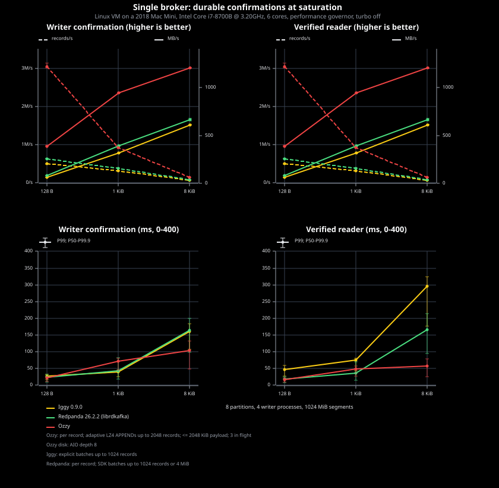
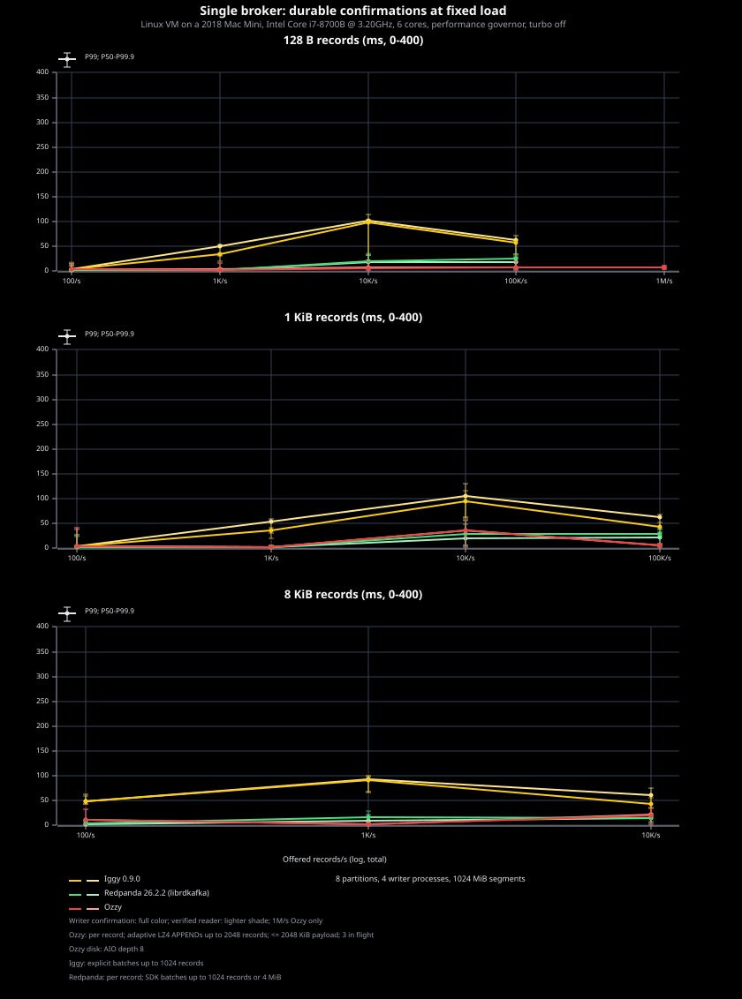
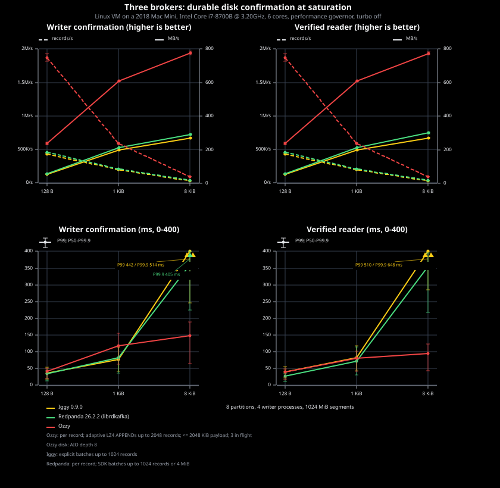
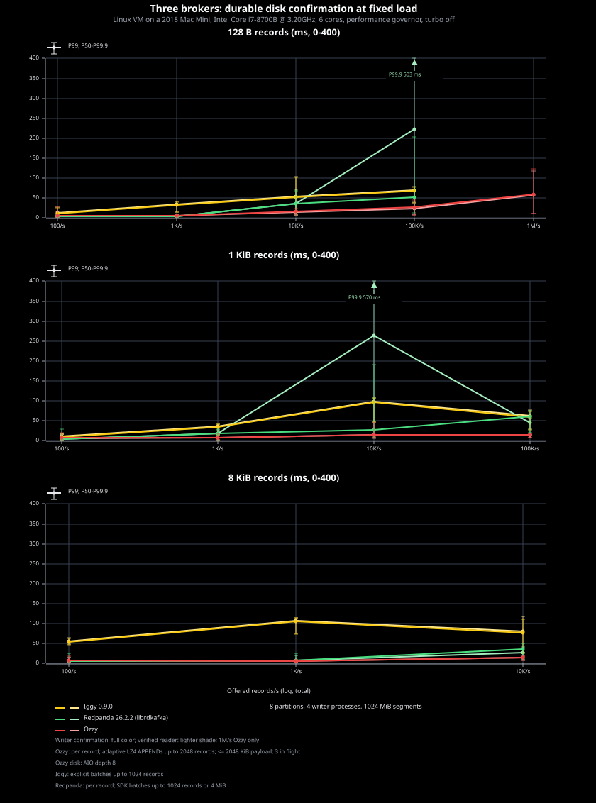

# Benchmarks

Four charts compare Ozzy with Iggy and Redpanda in each mode: throughput at
saturation and latency at fixed load. To reproduce them, use the
[benchmark commands](ozzy-bench/README.md) and follow its
[measurement rules](ozzy-bench/README.md#measurement-rules).

## Conditions

| Condition | Value |
| --- | --- |
| Topic | 8 partitions, 1 GiB segments, the same SSD for every system |
| Clients | 8 writers in 4 writer processes and 8 verified readers; each process on one client core in turn |
| CPUs | Single broker: 2 broker cores. Three brokers: 1 core each. Clients use separate cores |
| Records | 128 B, 1 KiB, or 8 KiB: an 8-byte clock plus varying JSON event text |
| Saturation | 2 s warmup, 8 s measurement, two repetitions; four for Ozzy at 128 B |
| Fixed load | 2 s warmup, 100/s for 30 s, then 1k/s, 10k/s, 100k/s, and for 128 B 1M/s, 8 s each |
| Fixed-load repetitions | Two for Ozzy, one for Iggy and Redpanda |
| Fixed-load ceiling | 1M/s for 128 B (Ozzy only), 100k/s for 1 KiB, 10k/s for 8 KiB |
| Latency | From the scheduled arrival, including any wait |
| Rates | Records and raw payload bytes |

- Runs are serial on an idle machine. Hardware appears below each chart title.
- Event text shares keys, so it compresses, but bodies differ within each
  APPEND and LZ4 window. LZ4 keeps about 26% of raw bytes.
- Every system receives the same bytes, and readers verify all of them.
- Captions show batching, compression, and outstanding requests. Legends show
  the compared versions.
- Failed loads and latency above the 400 ms axis are labeled.

## Single broker: durable

## Three brokers: disk quorum

