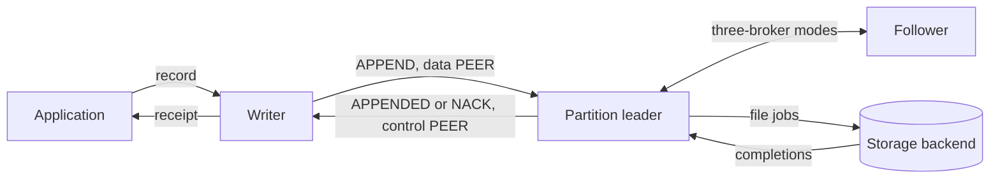
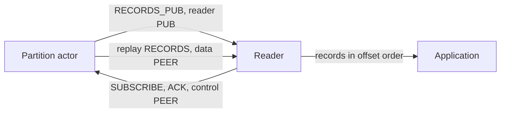

# Overview

This page defines Ozzy's terms, its two modes, and how records flow from
producers through brokers to consumers. Other docs link here for definitions.

Ozzy is a broker-owned, partitioned record log over OMQ. Brokers own storage,
replication, and confirmation. SDKs own client state. OMQ provides routing,
framing, reconnects, fairness, and transport backpressure.

## Terms

| Term | Meaning |
| --- | --- |
| Accepted | History the leader validated as contiguous; not yet confirmed |
| APPEND | One SDK request: consecutive records from one producer epoch to one partition. Not a transaction |
| Applied | Committed history installed for readers and replies |
| Authority | The fences a request or job must match: group, configuration, view, partition, owner |
| Broker | One server process, named under `[brokers.NAME]`. Owns its journals, replication state, and confirmations |
| Canonical operation | One validated history entry, with a partition-local operation number and digest |
| Committed | History that met the cluster mode's confirmation policy |
| Confirmation | The broker's statement that records met the cluster mode's confirmation policy. The writer turns it into receipts |
| Consumer checkpoint | Next offset per partition, saved by the application (`TopicCheckpoint`) |
| Consumer group | Named set of `GroupReader` members on one topic. Brokers assign its partitions and store its progress |
| Coordinator | The partition, chosen by group name, whose journal stores a consumer group's membership and plans |
| Dedup window | Logical time (`window_millis`) in which the first record with a message ID wins on its partition. Repeats do not extend it |
| Delay | Topic option that lets producers give each record a due time. Off by default |
| Dispatcher | Broker thread that owns the public sockets and sessions and routes messages to shards |
| Due time | Absolute Unix milliseconds a producer gives a scheduled record (`RecordInput::with_due_millis`). The leader's clock decides when it is reached |
| Durable | History protected by the required barriers and restart evidence |
| Eligible copy | A partition copy that may vote. Copies in recovery or quarantine are nonvoting |
| Follower | A broker whose copy of a partition is not the leader in the current view |
| Generation | Fence for one subscription attempt |
| Group progress | Next offset per partition that brokers store for a consumer group, confirmed like records |
| Incarnation | Persistent ID of a topic or partition. A reused name never adopts an old store |
| Journal | One partition's append-only history on one broker, stored as segments |
| Leader | The broker that admits writes for a partition in the current view |
| Message ID | Nonzero 16-byte ID the producer gives each record (`MessageId`). Deduplication keys on it |
| Mode | Single durable or disk quorum; see [modes](#modes) |
| Offset | A record's position in its partition, from zero, shared by all producers |
| Partition | Ordered log within a topic, shared by producers. Each broker runs one actor and one journal per partition |
| Partition actor | Task on a shard that owns one partition's journal, replication state, readers, and dedup index |
| Physical write group | One aligned segment write holding one or more canonical operations |
| Producer epoch | Generation of one producer on one partition. Takeover advances it and fences older writers |
| Producer sequence | Contiguous per-producer position within one partition and epoch, used for retries. Independent of offsets |
| Reader | Consumer SDK handle (`TopicReader`, `GroupReader`) that reads confirmed records in partition order |
| Receipt | Per-record result: confirmed sequence, original offset, achieved policy, and whether this attempt stored the record, found a duplicate, or scheduled it |
| Release | The leader copies due scheduled records into the log, in due order, at the next offsets. Readers see them from then on |
| Replica receipt | A follower's report of the prefix it retains |
| Retained backing | The whole allocation held by messages or aliases. Dequeue frees only the queue slot |
| Retention floor | Earliest readable offset. Older reads fail explicitly |
| Retry floor | Earliest producer sequence that still has an exact retained result |
| Retry identity | Partition, producer ID, epoch, sequence, and the exact record identity and bytes |
| Schedule sequence | Contiguous per-partition position of a scheduled record. A scheduled receipt carries it instead of an offset |
| Segment | Append-only journal file of canonical operations and record payloads. Retention deletes whole segments |
| Session | Fence for one link attempt. Does not replace durable authority |
| Shard | Broker-local thread that hosts many partition actors. Shard IDs never reach SDKs or storage |
| Storage checkpoint | Saved canonical state and original chain anchor. Payloads stay in segments |
| Topic | Named, immutable set of partitions with one partitioner seed. No order across partitions |
| View | Replication term of a partition's three-broker group. A view change elects a new leader |
| Vote | A follower's durable-prefix evidence that its copy counts toward confirmation |
| Writer | Producer SDK handle (`SharedTopicWriter`) that routes, batches, and retries records for one topic |

## Modes

`cluster.mode` is `single` or `three`; it is set explicitly, never inferred.
It fixes the confirmation policy of every topic.

| Mode | `cluster.mode` | A confirmation means | Availability |
| --- | --- | --- | --- |
| Single durable | `single` | The sole broker applied its synchronized local prefix | No failover |
| Disk quorum (DQ) | `three` | Leader and one follower applied matching synchronized history | Two of three brokers |

- Transport receipt and buffered write completion never prove durability.
- Single durable has no elections or failover.
- A failed three-broker group never becomes a single broker.
- [Replication](REPLICATION.md) owns voting and elections;
  [storage](STORAGE.md) owns barriers and the failure model.

## Placement

- Every broker in a three-broker group stores every partition.
- Each partition elects its own leader: `brokers[view % 3]` over the persisted
  broker order.
- Each broker places partitions on its own shards. Shard counts may differ
  between brokers.
- Routing hints and shard IDs grant no authority.

## Record flow

### Writing

Writers route each record before batching: an explicit numeric partition,
keyed records by key hash, or keyless records to one partition per batch.
Retries keep their partition across leader changes.
[Protocol](PROTOCOL.md#topic-and-routing-contract) owns the hash.

- `send` admits a record locally. `confirmed()` and `flush` wait for the
  mode's confirmation.
- A timeout leaves the outcome unknown. Retry the same identity and bytes; a
  confirmed retry returns the original offset.
- Resume restores producer epochs and sequences; takeover fences the old
  producer. Neither is an outbox: a crash can lose unconfirmed input.
- A session with no open or append for `producer_idle_secs` (7 days) retires
  with its retry results. Its writer then fails as fenced; resuming its
  identity starts fresh sequences.
- On a topic with delay, a record with a due time is held: its receipt
  carries a schedule sequence and readers see nothing yet. At its due time
  the leader releases it at the next offset. Releases follow due time, then
  acceptance order; a due time already past releases at once. Cancel and
  deduplication are left to the application.

### Reading

- Readers see only confirmed, applied records, in partition order.
- Lost PUB messages are repaired over PEER from the next undelivered offset.
- Slow consumers hold back neither producer confirmation nor retention.
- Processing is at least once. Save consumer checkpoints or acknowledge records
  to a consumer group, and tolerate replay. Ozzy never provides exactly-once
  processing.
