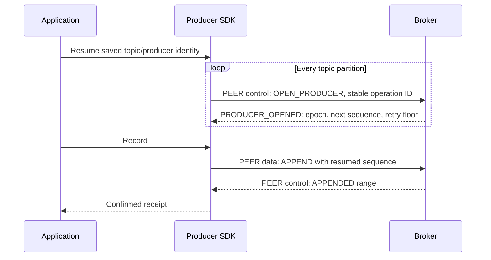
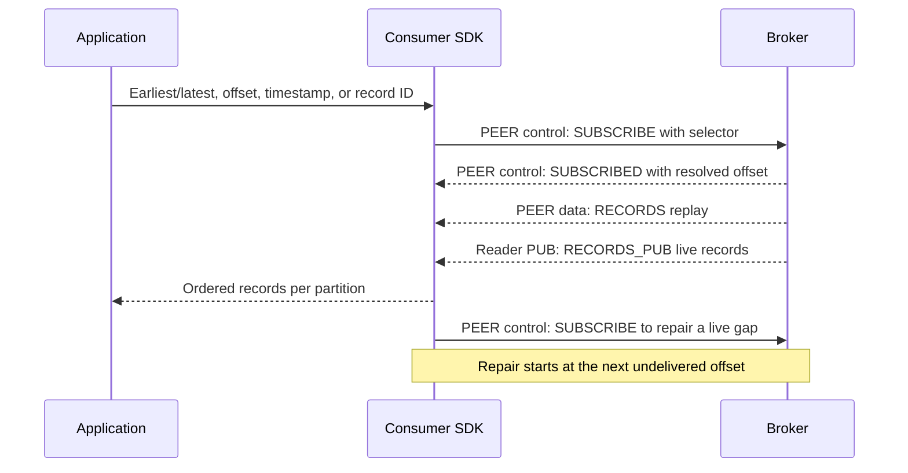

# Protocol

This page defines the Ozzy wire protocol: socket planes, exact bytes, commands,
sessions, and errors. It is for SDK, broker, and tool authors. Terms are defined
in [Overview](OVERVIEW.md#terms).

Ozzy commands are ordinary OMQ messages. OMQ routing frames sit outside the
Ozzy frames. Transport receipt is never record confirmation.

## Socket planes

| Socket | Carries |
| --- | --- |
| Control PEER | HELLO/WELCOME, NACK, topic lookup, routing watches, producer open, APPENDED, subscription control and ACK, progress, groups, replica control, REPLICA_RECEIPT |
| Data PEER | APPEND, RECORDS replay, PREPARE_FLOW, OPS, SNAPSHOT_CHUNK |
| Reader PUB | RECORDS_PUB |
| Follower PUB | PREPARE_PUB |
| Admin PEER | [Admin console](#admin-console) requests and replies, outside the envelope |

- An SDK opens one control and one data PEER socket per broker; partitions add
  no sockets. Both share one broker identity and session, with separate
  capacity. Data connections never negotiate a session.
- There is no wire credit or grant. A full receiver pauses its exact source.
- `lz4+tcp://` and `zstd+tcp://` change only the transport.
  [Runtime](RUNTIME.md#deployment-configuration) owns their configuration.

## Topic and routing contract

- A topic binds an immutable ID, partition count and order, XXH3-64 seed,
  limits, and per-partition group, configuration epoch, incarnation, and
  policy. Topic config `partitions` sets the count (default 16).
- Keyed routing is `XXH3-64(key, seed) % count`. Keyless placement is sticky
  within SDK batching. An explicit numeric partition bypasses both choices;
  an unknown number fails locally before admission, without fallback.
  Routing precedes sequencing; retries keep the partition across leader changes.
- One APPEND carries one producer, epoch, and partition. Producers share
  partition offsets but keep independent sequences.
- HELLO establishes a broker link, not partition ownership. Groups have one
  broker (local durable) or exactly three. Shard IDs never reach the wire.
- Wrong-leader replies are scoped hints. Brokers do not forward SDK APPENDs.
- Online topic creation or expansion, discovery, and broker membership change
  do not exist.

## Envelope and primitive encoding

Full commands have three frames after OMQ routing frames:
`[64-byte envelope] [metadata] [payload]`. Empty frames remain present.

| Offset | Width | Envelope field |
| ---: | ---: | --- |
| 0 | 4 | Magic `OZY` followed by zero |
| 4 | 1 | Version, `1` |
| 5 | 1 | Opcode |
| 6 | 2 | Flags; bit 0 response, others zero |
| 8 | 16 | Request ID; zero only for uncorrelated notifications |
| 24 | 16 | Sender node ID |
| 40 | 16 | Negotiated link session ID; zero for HELLO, PREPARE_PUB, and RECORDS_PUB |
| 56 | 4 | Metadata frame length |
| 60 | 4 | Payload frame length |

- Integers are unsigned big-endian. IDs are 16-byte UUIDs; digests are 32
  bytes. `text/blob = u32 length + bytes`; text is UTF-8.
- `list<T> = u32 count + items`; `optional<T> = u8 tag (0/1) + value if
  present`. Fields appear in listed order without alignment. No JSON.
- All lengths are bounded before decoding or allocation. Unsupported versions,
  flags, tags, opcodes, overflow, malformed lengths, and trailing bytes fail.
- Sender is nonzero. A response needs a request ID. Only HELLO, PREPARE_PUB,
  and RECORDS_PUB omit the session; the two publications also omit the
  request ID.
- OMQ routing label: a node ID with a leading zero byte uses `0x01 || node_id`
  (17 bytes); others use their 16 bytes. Only canonical labels are accepted.

## Handshake and sessions

HELLO metadata is `instance_id:u128, hello_nonce:u128, properties`, both
nonzero. HELLO has a request ID, no session, no response flag, and no payload.
WELCOME is the correlated response: it carries the responder's own
`instance_id`, echoes `hello_nonce`, and sets a fresh nonzero session in its
envelope. Later traffic uses that session.

Properties are `u8 ASCII-name length, name, u32 value length, value`, with no
outer count. At most 32 properties; case-insensitive duplicates fail; unknown
names are ignored. All listed properties except `superseded-hello` are
required.

| Property | Value encoding |
| --- | --- |
| `versions` | `u32` count + `u8` majors; must include 1; WELCOME selects exactly 1 |
| `capabilities` | `u32` count + strictly ascending `u16` IDs, at most 64 |
| `required-capabilities` | Same encoding; selected set must contain all |
| `max-metadata-bytes` | `u32`, at least 512 |
| `max-payload-bytes` | `u32` |
| `max-record-bytes` | `u32`, total payload across one record's parts |
| `max-batch-records` | `u32` |
| `max-payload-parts` | `u32` |
| `roles` | `u32` bit set, bits 0..4: producer, consumer, owner, replica, directory |
| `superseded-hello` | `u128`, WELCOME only |

- Receive bounds are nonzero and directional; each side advertises its own.
- Roles are nonzero and advertise behavior, not authorization.
- The selected set is the intersection and must hold every capability either
  side requires. WELCOME's `capabilities` is the selected set.
- IDs above 14 are ignored in `capabilities` and fail in
  `required-capabilities`.

| Capability | Meaning |
| ---: | --- |
| 1 | Owner append |
| 2 | Confirmed progress |
| 3 | Durable inbox |
| 4 | Durable VSR |
| 6 | Snapshot transfer |
| 7 | Directory state |
| 8 | Consumer-group membership and source activation; requires 12 |
| 9 | Replica receipt flow |
| 10 | Owner authority hints |
| 11 | Reader delivery/volatile progress |
| 12 | Durable consumer progress; requires 11 |
| 13 | Streaming append; requires 1 |

- Capabilities 5 and 14 are unassigned. Brokers advertise 1, 8, 10, 11, 12,
  and 13 and require none; the other IDs have no implementation.
- Brokers accept APPEND only on links that selected 13. Group-aware writers
  also require 10. Reader-only links need no writer capabilities.

Link rules:

- States: `Disconnected -> Negotiating -> Established -> Closing`.
- An identical HELLO reuses its session. A newer nonce from the same instance
  gets a new session; older nonces are dropped.
- Simultaneous HELLO: the lower node ID wins. WELCOME may name the abandoned
  nonce in `superseded-hello`.
- Replacement drops correlation and subscriptions; the client renegotiates and
  resubscribes. Retry identities survive.
- Unknown, pre-handshake, and stale-session packets are dropped. Malformed
  requests on an established link get a typed NACK where possible.
- Negotiation is not authentication. Cancellation stops observation, not
  admitted work.

## Common records

| Type | Ordered fields |
| --- | --- |
| Authority | group_id:u128, config_epoch:u64, view:u64 |
| Partition | incarnation:u128 |
| AppendKey | producer_id:u128, producer_epoch:u64, first_sequence:u64 |
| Position | optional<u64> |
| OpPosition | op:u64, digest:32 bytes |

- Operations start at 1; genesis is op 0 with zero digest. Partition offsets
  start at 0. `u64::MAX` is not an admissible operation position.
- Policy IDs: 1 local durable, 2 disk quorum. Other values fail. Group
  configuration fixes the policy; requests cannot weaken it.

`Records = count:u32 + descriptors`. Descriptor:
`message_id:u128, tagged_part_count:u32, decoded_bytes:u32 (LZ4 only), lengths:u32[]`.

- Low 24 count bits give the wire parts; the high byte is codec 0 raw or 1 LZ4.
- Each record has at least one part. The payload concatenates parts exactly;
  empty parts remain distinct.
- An LZ4 record has one wire part: original `u32` count and `u32` lengths,
  then a raw LZ4 block. Readers restore the exact output and part boundaries.

## Command allocation

| Opcodes (hex) | Commands in ascending order |
| --- | --- |
| `01..03` | HELLO, WELCOME, ERROR |
| `10..17` | APPEND, APPENDED, LOOKUP_APPEND, APPEND_STATE, OPEN_PRODUCER, PRODUCER_OPENED, ACK_RESULTS, RESULTS_ACKED |
| `20..28` | SUBSCRIBE, SUBSCRIBED, RECORDS, ACK, PROGRESS_COMMIT, PROGRESS_COMMITTED, unassigned, UNSUBSCRIBE, UNSUBSCRIBED |
| `30..3f` | REPLICA_OPEN, REPLICA_STATE, PREPARE, PREPARE_OK, COMMIT, START_VIEW_CHANGE, DO_VIEW_CHANGE, START_VIEW, RECOVERY, RECOVERY_STATE, FETCH_OPS, OPS, SNAPSHOT_BEGIN, SNAPSHOT_CHUNK, SNAPSHOT_END, SNAPSHOT_INSTALLED |
| `40..43` | STATE_SNAPSHOT_REQUEST, STATE_SNAPSHOT, STATE_UPDATE, STATE_RESYNC |
| `50..55` | EXIT_VIEW, PREPARE_FLOW, PREPARE_PUB, RECORDS_PUB, REPLICA_RECEIPT, HISTORY_RETIRED |
| `60..67` | GROUP_JOIN, GROUP_JOINED, GROUP_ASSIGN, GROUP_ASSIGNED, GROUP_INSPECT, GROUP_INSPECTED, GROUP_DELETE, GROUP_DELETED |
| `7f` | NACK |

- Unknown opcodes fail. Wire major 1 is the sole decoder. Only negotiated
  command families are usable.
- No codec exists for ERROR, LOOKUP_APPEND, APPEND_STATE, ACK_RESULTS,
  RESULTS_ACKED, SNAPSHOT_END, or SNAPSHOT_INSTALLED.
- Brokers reject plain PREPARE on PEER; they send PREPARE_FLOW or PREPARE_PUB.
- General directory revision and update services are reserved.

## Topic lookup

STATE_SNAPSHOT_REQUEST/STATE_SNAPSHOT tag 0 carries topic pages on control
PEER. Payload is empty. Request: tag `u8=0`, name length `u8`, ASCII name,
first partition `u32`, maximum entries `u16` (nonzero). Response, in order:

1. Tag `u8=0`, topic ID `16`, name (`u8` length + ASCII), algorithm `u8=1`,
   seed `u64`, total/first partition `u32` each, policy `u8`, broker count
   `u8`.
2. Broker entries: node ID `16`, three `u16`-length UTF-8 endpoints (control
   PEER, reader PUB, optional follower PUB; zero length absent).
3. Entry count `u16`; contiguous entries: number `u32`, group ID `16`, config
   epoch `u64`, incarnation `16`, member count `u8`, ordered member IDs `16`
   each.

- Topic names are 1..128 bytes of `a-z`, `0-9`, `-`, `_`, `.`, starting with a
  letter or digit. An unknown topic fails with code 18.
- One broker requires policy 1; three brokers require 2. Each partition
  lists every page broker once, initial leader first.
- Endpoints use `tcp`, `lz4+tcp`, `zstd+tcp`, `ipc`, or `inproc` and are at
  most 1,024 bytes.
- Pages shrink to negotiated bounds. Clients advance by the returned count and
  compare repeated topic fields.
- Pages carry no data PEER endpoint and no shard placement. SDK configuration
  supplies data endpoints.

## Routing interests

Watch tag 1 carries session-scoped leader hints, never authority. Payload is
empty.

| Command | Metadata after tag `u8=1` | Envelope request ID |
| --- | --- | --- |
| `STATE_SNAPSHOT_REQUEST` | watch ID `16`, group count `u16`, group IDs `16` each | required request |
| `STATE_SNAPSHOT` | watch ID `16`, route count `u16`, route entries | required response |
| `STATE_UPDATE` | watch ID `16`, one route entry | absent notification |
| `STATE_RESYNC` | watch ID `16` | absent notification |

Route entry: group ID `16`, config epoch `u64`, incarnation `16`, member count
`u8`, ordered member IDs `16` each, view `u64`, leader ID `16` (zero unknown).

- Watch ID and config epoch are nonzero. Member counts are 1, 3, or 6; six
  defines no quorum policy.
- Views compare only within matching group, incarnation, configuration, and
  membership. Equal-view conflicting leaders fail; an unknown leader may
  become known.
- Updates coalesce; overflow emits STATE_RESYNC. Lost notices, timeouts, or
  wrong-leader replies trigger a fresh snapshot. Replacement drops interests.

## Producer exchange

Producer commands need the producer role (else code 3). Every layout starts
with tag `u8=1`. Payload is empty except for APPEND.

| Command | Metadata |
| --- | --- |
| OPEN_PRODUCER (90 bytes) | tag, Authority, partition incarnation, producer ID, mode `u8`, expected epoch `u64` (0 absent), operation ID `16` |
| PRODUCER_OPENED (90 bytes) | tag, Authority, partition incarnation, producer ID, epoch `u64`, next sequence `u64`, retry floor `u64`, policy `u8` |
| APPEND | tag, Authority, partition incarnation, owner epoch `u64`, AppendKey, policy `u8`, payload codec `u8`, decoded payload bytes `u32`, Records |

OPEN_PRODUCER:

- Mode `0` resume returns the current session, or creates one when none is
  live: epoch 1, or one above every retired epoch on the partition. An
  expected epoch must match. Mode `1` fence requires an expected epoch and
  commits a newer one. Mode `2` create forbids an expected epoch and rejects
  existing identities.
- The leader retires a session with no open or append for the topic's
  `producer_idle_secs`, retry results included. Its later requests fail with
  code 6, like a fenced session's.
- Retries keep the operation ID. The latest transition identity survives
  checkpoints and history retirement. The reply follows confirmation.
- The retry floor (at most the next sequence) is the exclusive sequence below
  which exact retry results are gone. Newer epochs fence old ones.

APPEND:

- Metadata is 99 fixed bytes plus `20 + 4*part_count` per descriptor.
- IDs, epochs, and message IDs are nonzero. Count is nonzero; sequence and
  offset exclusive ends must fit `u64`.
- Descriptors are raw. Codec 0 payload equals the decoded bytes. Codec 1 is
  one nonempty raw LZ4 block over all parts with that exact decoded length.
- SDKs try LZ4 from 2 KiB raw and send it only when smaller. Brokers check
  LZ4 syntax and length without allocating output.
- Brokers may pack a fresh raw APPEND before canonical hashing. Retries and
  replicated canonical bodies keep their exact encoding.
- Policy must equal the partition policy (else code 2).
- Retries match on message IDs, part boundaries, and bytes. Accepted-only
  matches await confirmation; confirmed matches return original offsets;
  conflicts fail with code 8, expired history with code 9.
- Timeout or cancellation leaves the outcome unknown, including for an
  earlier successful attempt.

List-form APPENDED has a codec, but brokers do not send it: tag, Authority,
partition, owner epoch, AppendKey, first offset `u64`, count `u32`, achieved
policy, OpPosition, `list<message ID>`. Metadata is 146 fixed bytes plus 16
per message ID; both counts agree; the position is never genesis.

### Streaming writer profile

Capability 13 selects consecutive record-based APPEND and range confirmation.
Negotiated bounds apply. Packet boundaries imply no transaction. APPENDED has
107 metadata bytes and empty payload:

| Offset | Width | Field |
| ---: | ---: | --- |
| 0 | 1 | Group tag, 1 |
| 1 | 88 | Authority, partition, owner epoch, append key |
| 89 | 8 | Exclusive confirmed sequence end |
| 97 | 8 | First confirmed partition offset |
| 105 | 1 | Disposition: stored 0, duplicate 1 |
| 106 | 1 | Achieved policy |

- A nonempty range binds one producer, epoch, partition, owner, policy, and
  disposition. It may confirm part of a request, span requests, or overlap a
  confirmed prefix; it never skips records.
- The request ID names a live APPEND holding part of the range. Clients check
  sender, session, authority, sent bounds, and the sequence-to-offset mapping.
- Duplicates return original offsets, which may repeat or move backward
  across ranges. Disposition and offset never change for a confirmed sequence.
- Disk quorum replies follow applied synchronized history.
- Reconnect discards correlation; unresolved records retry unchanged.
  [Runtime](RUNTIME.md#sdk-protocol-batching) owns SDK batching defaults.

### Producer resume

## Reader exchange

Capability 11 provides confirmed delivery and volatile progress. Reader
commands need the consumer role (else code 3).

- Subscription is `(id:u128, generation:u128)`, both fresh and nonzero.
- Target/Source tag 1: Authority, incarnation `u128`, owner_epoch `u64`.
- Target tag 0: stream `text`, topic `text`, local partition `u32`. Source
  tag 0: producer_id `u128`, local partition `u32`. Brokers serve only tag 1.
- Names are nonempty UTF-8, at most 255 bytes.

| Command | Metadata fields |
| --- | --- |
| SUBSCRIBE | Subscription, Target, Start |
| SUBSCRIBED | Subscription, Source, resolved offset:u64 |
| RECORDS | Subscription, Source, first offset:u64, payload codec:u8, decoded payload bytes:u32, Records |
| ACK | Subscription, Source, received:optional<u64>, processed:optional<u64> |
| UNSUBSCRIBE / UNSUBSCRIBED | Subscription, Source, resolved offset:u64 |

| Start tag | Selector/result |
| ---: | --- |
| 0 | Earliest retained offset |
| 1 | Current confirmed end |
| 2 | Exact offset:u64 |
| 3 | Unix append time:u64 milliseconds; lowest qualifying confirmed retained offset, else end |
| 4 | Record ID:16, duplicate policy:u8 (0 unique, 1 first retained, 2 last retained) |

- Selectors resolve once. Reconnect and repair use the next undelivered
  offset. Identical SUBSCRIBE keeps state; changes need a fresh generation.
- SUBSCRIBE starts persistent pushed replay; there is no READ/FETCH. RECORDS
  is an uncorrelated notification of whole contiguous records through applied
  confirmation. Every delivery checks session, generation, and source.
- RECORDS uses APPEND's outer codec. Whole stored blocks pass through; partial
  or packet-limited reads send raw records.
- Missing or reordered replay opens a fresh generation. Retention and oversize
  errors are explicit; records are never split or skipped.
- ACK positions are inclusive, volatile, and processed <= received. ACK is an
  uncorrelated notification or a correlated request the broker echoes. It
  grants no capacity, write confirmation, or durable progress.

### Consumer history selection

### Durable consumer progress

Capability 12 uses correlated control requests on the source link and needs a
current source assignment.

| Command | Metadata after source tag `u8=1` | Payload |
| --- | --- | --- |
| PROGRESS_COMMIT | Authority, partition incarnation, consumer group ID, member ID, assignment epoch:u64, policy:u8, cursor tag:u8, cursor:u64 | Empty |
| PROGRESS_COMMITTED | Same identity/policy fields, cursor:u64, retained floor:u64, confirmed end:u64 | Empty |

- Metadata is 99/114 bytes. IDs and assignment epochs are nonzero.
- Queries use tag/value `0/0`. Updates use tag `1` and an exclusive cursor,
  including zero.
- Member, epoch, authority, and policy are fenced before admission. Updates
  cannot exceed the confirmed record end.
- Covered retries wait for their accepted prefix without appending. Queries
  read confirmed state.
- Resuming below retained history fails with code 9 and detail
  `cursor:u64, retained floor:u64`. A covered update may confirm a cursor
  below the floor; that does not claim the history is replayable.
- Confirmation proves the source policy boundary, never exactly-once
  application processing.

### Consumer groups

Capability 8 adds membership and activation. All group commands are
correlated control requests with empty payloads. IDs are nonzero unless
stated.

| Command | Metadata bytes | Metadata after source tag `u8=1` |
| --- | --- | --- |
| GROUP_JOIN | 112 + name + 32/owned | Authority, coordinator incarnation, name (`u8` length, UTF-8), member ID, join ID, group ID, mode `u8`, start selector, owned list |
| GROUP_JOINED | 78 + 45/target | Authority, coordinator incarnation, group ID, revision `u64`, status `u8`, target list |
| GROUP_ASSIGN | 99 | Authority, source incarnation, group ID, member ID, plan revision `u64`, start selector, policy `u8` |
| GROUP_ASSIGNED | 122 | Authority, source incarnation, group ID, member ID, epoch `u64`, plan revision `u64`, cursor `u64`, retained floor `u64`, confirmed end `u64`, policy `u8` |
| GROUP_INSPECT | 50 + name | Authority, coordinator incarnation, name |
| GROUP_INSPECTED | 90 + 48/member + 44/target | Authority, coordinator incarnation, group ID, revision `u64`, start selector, member list, target list |
| GROUP_DELETE | 66 + name | Authority, coordinator incarnation, group ID, name |
| GROUP_DELETED | 66 | Authority, coordinator incarnation, group ID, status `u8` |

- Names are 1..255 bytes. Lists are a `u32` count plus entries:
  - Owned (at most 1,024): partition incarnation, plan revision, epoch.
  - Joined target (at most 1,024): partition incarnation, number `u32`, plan
    revision, activatable `u8`, prior member ID or zero.
  - Inspected member (at most 256): member, node, and join IDs.
  - Inspected target: partition incarnation, number `u32`, plan revision,
    member ID or zero.
- Join modes: `0` heartbeat, `1` join, `2` leave.
- Start selector (9 bytes): tag `0` earliest, `1` latest, or `2` plus an exact
  offset `u64`. It applies only to a source without persisted progress and is
  fixed at group creation.
- Join group ID: the incarnation the instance first joined, or zero.
- Joined status: `0` member (targets follow); `1` joining, `2` unknown, `3`
  deleted (no targets). A zero group ID appears only while the group is being
  created or after deletion.
- Deleted status: `0` this request retired the incarnation, `1` already gone.

Rules:

- A group belongs to one topic. Its coordinator is partition
  `XXH3-64(name, topic seed) % count`, whose journal holds membership and
  plans. Replies follow the coordinator or source confirmation boundary.
- Members join on the coordinator leader, then relay each committed target to
  its source leader with GROUP_ASSIGN. The source allocates the epoch,
  captures the resume cursor, and fences older revisions.
- A later join of the same member ID fences the earlier instance. A
  coordinator that no longer holds the join's group ID replies status `3`.
- A target is activatable once every older owner released it, left, timed
  out, or passed the drain deadline. The owner can be older than the prior
  member when a target moves again before it activates. A new coordinator
  leader treats each member's ownership as unknown until its report or a
  full drain deadline.
- A repeated plan revision returns the original epoch and cursor. Older
  revisions and fenced joins fail with code 6; a different owner for the same
  revision with code 8; a creation offset outside confirmed retained history
  with code 7.
- A zero member ID revokes the source. Deletion revokes at plan revision
  `u64::MAX`, fencing every plan, epoch, and progress update of that
  incarnation.
- GROUP_INSPECT reads the committed image; an unknown name yields a zero group
  ID, revision zero, and empty lists.
- GROUP_DELETE retires the incarnation if the name still holds it; a plan or
  deletion in flight fails with code 10. Clients revoke every source first.

### Live reader publication

| Frame | Contents |
| --- | --- |
| 0 | Topic: group ID (16 bytes), then partition incarnation (16 bytes) |
| 1 | `RECORDS_PUB` (`0x53`) envelope, no link session or request ID |
| 2 | Source, first offset:u64, payload codec:u8, decoded payload bytes:u32, record descriptors |
| 3 | Packed raw payload or one exact producer LZ4 block |

- RECORDS_PUB is RECORDS without Subscription. Only group sources (tag 1)
  publish, including single-broker durable.
- Confirmed applied records are published once, in offset order.
- A SUB prefix of the bare group ID receives every partition of the group.
  Any endpoint reader can subscribe to any published partition.

| State | Delivers | Replay subscription |
| --- | --- | --- |
| Replay | SUBSCRIBE at the next offset, bounded replay | Open |
| Live | Publications only | Canceled with UNSUBSCRIBE |

- A publication covering the next offset ends replay and drops overlap. A
  later one is held while PEER repairs the gap. Quiet loss returns to replay.
- Every source is validated against SUBSCRIBED. A newer source discards held
  state and reopens; an older one is dropped. Expired repair returns NACK 14.

## Replica exchange

Replica metadata starts with 80 bytes: Authority, voter ID `u128`,
configuration digest `32`. The authenticated peer, envelope sender, embedded
voter, session, and configuration must match. Decoding grants no trust.

| Command | Metadata bytes | Fields after common replica prefix |
| --- | ---: | --- |
| REPLICA_OPEN | 128 | Outstanding tail `OpPosition`, available operation `u64`; nonzero request ID in envelope |
| REPLICA_STATE | 204 | Receive epoch `u128`, revision `u64`, base/received `OpPosition`, received body bytes `u64`, repair limit `u64`, compact handle `u32` |
| PREPARE | 164 + 86*N | First op, predecessor digest, commit position, list of canonical operation descriptors |
| PREPARE_FLOW | 180 + 86*N | Receive epoch `u128`, then the same fields as PREPARE |
| OPS | 196 + 86*N | Source descriptor, predecessor op position, list of canonical operation descriptors |
| PREPARE_OK | 120 | Contiguous durable op position |
| COMMIT | 120 | Committed op position |
| EXIT_VIEW | 80 | View to leave in Authority: the sender's current view, or an older view it left, answering a peer's request; volatile suspicion, no additional fields |
| START_VIEW_CHANGE | 80 | Proposed view in Authority; no additional fields |
| DO_VIEW_CHANGE | 184 | Frozen writer generation `u128`, last normal view `u64`, accepted end, commit floor |
| START_VIEW | 176 | Installed writer generation `u128`, selected accepted end, commit floor |
| RECOVERY | 97 | Fresh recovery-attempt nonce `u128`, nonvoting `u8` (0 restart probe, 1 nonvoting copy); correlated request ID in envelope |
| RECOVERY_STATE | 97, 194, or 350 | Echoed nonce `u128`, primary tag `u8`; if primary: writer generation `u128`, accepted and commit `OpPosition` |
| FETCH_OPS | 200 | Source descriptor, predecessor op position, maximum operations `u32`, maximum canonical body bytes `u32` |

PREPARE, PREPARE_FLOW, PREPARE_PUB, and OPS payloads concatenate canonical
bodies; all other replica payloads are empty. Descriptor (86 bytes):
`op:u64, original_view:u64, kind:u16, canonical_body_bytes:u32, body_digest:32, op_digest:32`.

- Operations chain consecutively by number and digest. Original views survive
  new-view forwarding. The canonical schema matches disk, not its padding.
- The receiver's operation limit bounds each PREPARE or OPS, independent of
  record count.
- PREPARE variants, PREPARE_OK, COMMIT, EXIT_VIEW, and election commands are
  uncorrelated. PREPARE_OK is cumulative.
- Election generations are nonzero `u128` incarnations. Proposed views exceed
  the last normal view; commits never pass or conflict with accepted history.
- [Replication](REPLICATION.md) owns voting, election, and
  [repair](REPLICATION.md#receipt-and-repair) rules.

### Live replica publication

| Frame | Contents |
| --- | --- |
| 0 | Group ID (16 bytes), the common SUB topic |
| 1 | `PREPARE_PUB` (`0x52`) envelope, no link session or request ID |
| 2 | PREPARE metadata, including leader view and configuration digest |
| 3 | Shared canonical operation bodies |

- One publication reaches both followers without recipient masks or credits.
- Publisher, leader, view, group, and configuration checks precede hashing.
  Only contiguous suffixes are admitted; gaps drop. Receipt never votes.

### Receipt and repair flow

REPLICA_OPEN has the accepted tail at byte 80 and the available op at 120, a
scheduling hint only. Brokers do not negotiate capability 9.

| REPLICA_STATE field | Offset / size |
| --- | --- |
| Receive epoch | 80 / 16 |
| Revision | 96 / 8 |
| Base / received OpPosition | 104 / 40; 144 / 40 |
| Cumulative body bytes | 184 / 8 |
| Repair ceiling (`u64::MAX` absent) | 192 / 8 |
| Compact handle | 200 / 4 |

- Epoch, revision, and handle are nonzero. Correlated replies echo the probe;
  same-epoch unsolicited reports are uncorrelated. Same-epoch counters never
  retract or wrap. The ceiling grants no capacity or history.
- Compact REPLICA_RECEIPT is one 29-byte frame with no envelope:
  `opcode:u8, handle:u32, revision:u64, received_op:u64, received_bytes:u64`.
  The full REPLICA_STATE binds the handle, which is never reused in a link
  session. Unknown history needs a full report. Compact receipts never vote.
- PREPARE_FLOW receivers check their locally issued epoch before hashing.

History source is `voter_id:u128, writer_generation:u128, accepted:OpPosition`.

- FETCH_OPS is correlated. OPS echoes the request ID with the response flag,
  comes from that source, and matches scope, session, predecessor, and limits.
- Nonzero count and byte limits are ceilings. Empty responses and requests at
  or beyond the tail fail.
- Verified transfer is neither installation nor commit.

### Lost-state recovery

The RECOVERY view is a hint. RECOVERY_STATE echoes request ID and nonce
under the responder's normal view. Only active normal voters answer. A voter
in an election treats a nonvoting RECOVERY from that view's primary as
suspicion of the view; a restart probe still votes.

| RECOVERY_STATE field | Offset / size |
| --- | --- |
| Nonce | 80 / 16 |
| Primary tag | 96 / 1 (0 backup, 1 primary) |
| Primary generation | 97 / 16 |
| Accepted / commit positions | 113 / 40; 153 / 40 |
| Checkpoint presence | 193 / 1 |
| Optional checkpoint | Predecessor/position 40 each, schema/state digests 32 each, length 8, chunk bound 4 |

- Backup metadata ends at 97; primary at 194, or 350 with a checkpoint.
- The nonce survives reconnect; request and session fences change.
- [Replication](REPLICATION.md#nonvoting-recovery) owns how recovery uses
  this evidence.

### Checkpoint state transfer

- SNAPSHOT_BEGIN/SNAPSHOT_CHUNK use 180 metadata bytes: common prefix, nonce
  `16`, exact source `72`, offset `u64`, byte bound `u32`.
- SNAPSHOT_BEGIN is the correlated request on control PEER. SNAPSHOT_CHUNK is
  the response on data PEER with a nonempty payload within the bound.
- Session, request, source, nonce, and next offset all match. State stays
  private until schema, digest, and original anchor validate.
- HISTORY_RETIRED (`0x55`) is uncorrelated, with 137 metadata bytes and empty
  payload: common prefix, fence tag `u8` (0 receive epoch, 1 fetch ID),
  receive epoch or fetch ID `16`, retained predecessor `40`. It tells a
  receiver to withdraw into recovery and grants no authority. See
  [retained history](REPLICATION.md#retained-history).

## Admin console

The optional `admin` endpoint is a PEER that announces the broker's peer
identity, as the control PEER does. A client PEER learns it from the
handshake, sends one request to it, and waits for the reply with the same ID.
Replies are observations, never authority. There is no authentication yet:
any client that connects is an admin. `ozzy-tui` from the `ozzy-ui` crate is the
terminal client.

Each message is one frame: kind `u8`, ID `u64`, body. Only a delete group
request has a body. Integers are big-endian, IDs 16 bytes. A string is a
`u16` length plus UTF-8; a list is a `u32` count plus items.

| Kind | Request | Reply body |
| --- | --- | --- |
| 1 | Broker | name, ID, pid `u32`, uptime ms `u64`, `max_clients` `u32`, shards `u32`, brokers (name, ID), partitions (group, topic, partition `u32`, shard `u32`) |
| 2 | Counters | uptime ms `u64`, events (name, kind `u8`: 0 count, 1 peak, 2 gauge), totals (`u64` per event), threads (name, `u64` per event) |
| 3 | Partitions | uptime ms `u64`, missing shards `u32`, rows |
| 4 | Connections | other brokers (ID, link up `u8`), connected clients `u32` |
| 5 | Delete group: topic, name | deleted `u8`, then the group ID when 1 |
| 6 | Logs | entries, oldest first (broker uptime ms `u64`, level `u8`: 0 info, 1 warn, 2 error, thread, message) |
| 255 | none | error message |

A partition row:

| Field | Encoding |
| --- | --- |
| group | ID |
| state | `u8`: 0 local, 1 normal, 2 electing |
| flags | `u8`: 1 ready, 2 disk pending, 4 leader known, 8 log follows |
| view, leader | `u64`, ID (zero when unknown) |
| positions | `u64` each: accepted, committed, applied, pending operations, pending body bytes, validation cycles, reclaimed bytes, written, durable, leader commit |
| followers | list of (ID, acknowledged `u64`); a leader lists both followers, others none |
| log | only with flag 8: first offset `u64`, next offset `u64`, producers `u32`, limits, groups, cursors |

- Positions are operation numbers. Only the log has record offsets.
- Limits are retention age ms `u64`, retention bytes `u64`, policy revision
  `u64`, segments `u32`, segment bytes `u64`, retained dedup identities
  `u64`, and the dedup identity limit `u64`. A zero limit means none; zero
  segments means the journal is being installed. Segment bytes sum the
  segment capacities, the size retention bytes limit.
- Groups are the consumer groups this partition coordinates: group ID, name,
  plan revision `u64`, members (member ID, client ID).
- Cursors are the groups reading this partition: group ID, flags `u8`
  (1 member, 2 offset), then the active member's ID and the exclusive
  committed offset `u64` when flagged.
- A partition whose journal is busy answers without its log; ask again.
- Delete group fences the group on every partition, then frees its name,
  like `BrokerLinks::delete_group`. Deleted 0 means no group has that name.
  The reply comes when the deletion ends, after other replies; a second
  deletion meanwhile gets an error.
- An unknown kind gets an error reply with the request's ID.
- A reply the client cannot take is dropped; the client times out.
- The last thread in a counters reply, `exited`, combines ended threads.

## Errors

Typed NACK is a correlated response with no payload. Metadata:
`code:u16, retry_class:u8, detail:blob, diagnostic:text`, 11 fixed bytes.
Retry classes 1..5: permanent, backoff, reconnect, authority refresh, unknown
outcome. Each NACK carries its class; the table shows the usual one.
Diagnostics never determine behavior; unknown codes keep raw detail.

| Code | Meaning | Retry class |
| ---: | --- | --- |
| 1 | Malformed or oversized command, including an invalid dedup batch | permanent |
| 2 | Unsupported command or policy | permanent |
| 3 | Source/producer identity not authorized | permanent |
| 5 | Stale/foreign group, configuration, or view | after-authority-refresh |
| 6 | Unknown partition or fenced owner/producer/consumer assignment | permanent |
| 7 | Invalid sequence, processing cursor, or group start outside confirmed retained history | permanent |
| 8 | Retry identity conflicts with retained records | permanent |
| 9 | Retry or processing history expired | permanent |
| 10 | Capacity unavailable, including dedup identity capacity, or earlier writer sequences missing | after-backoff |
| 11 | Storage/validation uncertainty | unknown-outcome |
| 12 | Writer not admitted by current primary, or reader broker unavailable | after-authority-refresh |
| 13 | Authority changed after admission | unknown-outcome |
| 14 | Reader offset/retention gap | permanent |
| 15 | Unknown or replaced subscription generation | permanent |
| 16 | Requested offset beyond local confirmed end | permanent |
| 17 | Next indivisible record exceeds read bounds | permanent |
| 18 | Unknown topic, metadata partition, or routing-watch group | permanent |
| 19 | Record ID missing | permanent |
| 20 | Record ID ambiguous | permanent |

- Code 4 reserves stale-session rejection; native stale traffic is dropped.
- With capability 10, codes 5, 12, and 13 carry exactly 48 detail bytes:
  `group_id:u128, config_epoch:u64, observed_view:u64, primary_id:u128`.
  IDs and config epoch are nonzero. View 0 is valid and may name an
  unfinished election.
- Clients accept a hint only for the configured group, membership, and
  primary selection, and never for an older view. Hints grant no activation.

| Code | Native detail |
| ---: | --- |
| 9 (progress) | Cursor:u64, retained floor:u64 |
| 14 / 19 | Earliest retained offset:u64 |
| 16 | Confirmed end:u64 |
| 7 (group start) | Cursor:u64, retained floor:u64, confirmed end:u64 |
| 17 | Payload bytes:u64, parts:u64 |
| 20 | First/last matching offsets:u64 each |

Other details are empty.

## Limits

`DataLimits::default`: 64 KiB metadata, 16 MiB payload, 1 MiB/record, 1,000
records/APPEND, 4,000 parts. Negotiation and configuration may lower these.

- Every atomic record or operation must fit all required replica limits,
  including metadata.
- Decode, decompression, and scheduling have independent count and byte
  budgets. [Runtime](RUNTIME.md#backpressure-isolation) owns progress
  isolation.

## In the code

- `ozzy-proto/src/envelope.rs`, `handshake.rs`, `nack.rs`: envelope, opcodes,
  HELLO/WELCOME, NACK.
- `ozzy-proto/src/data/`, `append/`, `producer.rs`: records and producer
  commands.
- `ozzy-proto/src/reader/`, `progress.rs`, `group/`: reader, progress, groups.
- `ozzy-proto/src/directory/`: topic lookup and routing watches.
- `ozzy-proto/src/admin.rs`: admin console.
- `ozzy-replication/src/wire/`: replica commands.
- `ozzy-runtime/src/peer_sessions.rs`, `transport.rs`: link negotiation and
  OMQ routing labels.
