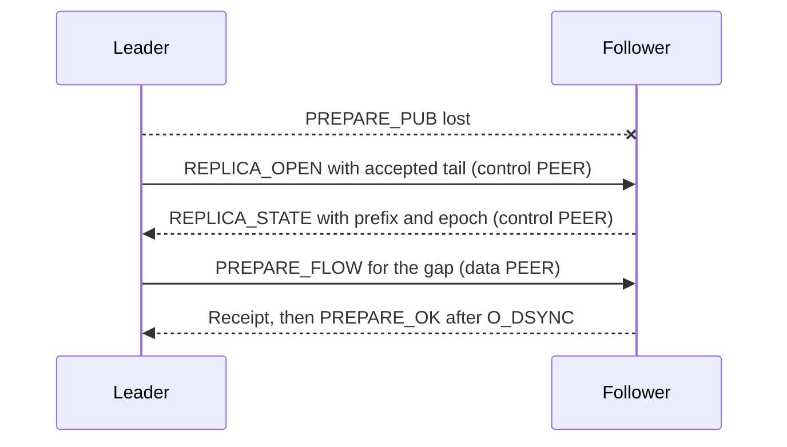
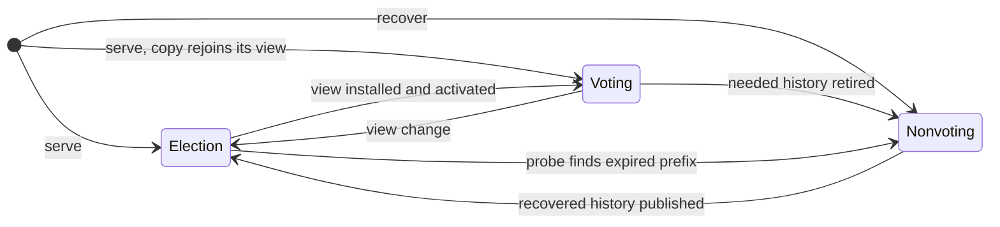

# Replication and recovery

Who may confirm a record in each mode, how leaders change, and how a broker's
partition copy restarts or recovers. For operators and contributors.
[Protocol](PROTOCOL.md) owns the wire bytes; [overview](OVERVIEW.md) owns the
terms.

## Authority

- Single durable confirms its applied local durable prefix. It has no votes,
  elections, or failover.
- Disk quorum (DQ) uses three fixed brokers. Confirmation needs two of three
  eligible copies.
- A failed replicated group never becomes a single-broker group.
- Each replicated partition is its own Viewstamped Replication group, with its
  own journal and view. All three brokers store it.
- The leader of view `v` is `brokers[v % 3]` in the persisted member order.
  Only an election activates it. `init` rotates the order per partition to
  spread leaders.
- A runtime log names its own members: one broker makes it single durable
  on that broker, three make it a group of its own. Brokers that are not
  members hold no copy and drop its traffic.
- One remaining broker never confirms. There is no forced promotion, lower
  quorum, or discard of confirmed history.
- `CONFIGURATION` (256 bytes replicated, 128 bytes single durable) binds group
  identity, members and principals, versions, and integrity profile.
  One mode's record never decodes as the other's.
- Missing or invalid configuration fails closed. Roll, retention, and suffix
  replacement never change membership.
- Hints, endpoints, and shard IDs grant no authority. Routing IDs need an
  independently trusted peer binding.
- Asynchronous work is fenced by configuration, view, session, receive epoch,
  and writer incarnation. Stale completions never advance state.

## Confirmation

- A vote reports the durable prefix of completed `O_DSYNC` writes.
- The leader commits through its own durable prefix and one matching
  follower vote. A follower applies through the announced commit, capped by
  its durable prefix.
- The storage deadline resets on durable progress.
- The leader freezes offsets, canonical bytes, and digest before any
  asynchronous work. Followers check authority, chain, schema, application
  transition, and bounds before accepting.
- Votes are cumulative and cannot skip a predecessor or change a digest.
- Transport receipt, queued I/O, and page-cache completion are not disk votes.
- The leader replies from applied state, possibly before it announces COMMIT.
  Elections preserve that history. A retry after a leader change gets its
  original result, rebuilt from canonical records.

## Live replication

- The leader publishes each PREPARE once on PUB to both followers. There are no
  recipient masks or follower credits.
- A full leader PUB socket delays publications. Full subscriber queues and
  gaps drop them; PEER repair fills them. Follower and reader publications
  use separate backing.
- OMQ keeps frames queued for a stalled subscriber, and they hold the shard's
  publication budget. After one second of refusal, publications drop until
  the budget has room. Writes continue with the other follower over PEER.
- Repair uses one data PEER connection per destination shard. A full shard
  pauses only that source; control and healthy copies continue.
- If both followers stall, the unconfirmed window fills and producers see
  backpressure.

## Receipt and repair

- Followers keep only a contiguous prefix. Leader probes find gaps, including
  a lost final publication.
- Followers report PUB receipt unasked, so new work does not hurry a probe.
  COMMIT and votes go out when they change. The heartbeat and retransmit
  timers repeat them, which covers a lost packet.
- Only an answered probe starts payload repair. Repaired operations get the
  same validation as live ones.
- A receipt reports a retained prefix and cumulative bytes. It grants no vote,
  capacity, or durability.
- Receive epochs are fresh and nonzero. Reset, view change, or restart fences
  old repair; a reconnect alone keeps retained work. An activated follower
  stages nothing until its receipt restarts for the new view.
- A new epoch needs a correlated probe and verified history. Counters within
  an epoch never retract or wrap.
- A channel's base is verified once, at open, so retention may retire it. Later
  receipts verify only the received prefix, and one journal lookup answers one
  report.
- The leader keeps one window in flight past its announced commit. Followers
  admit only inside it, and every owner of accepted but unapplied state holds
  up to two windows.
- A receipt releases sender metadata, never bodies the receiver still needs.
  Recent repair uses a bounded cache that never waits for slow followers; older
  repair reads the journal.

## Leader change

A broker suspects the leader when contact, commit progress, or storage
progress times out. Any current-view COMMIT from the leader is contact,
even one past the operations this copy holds. Storage stalls when an admitted write stays undurable,
or when a journal command, such as a sync or maintenance step, is pending
and the shard's storage lane completes no job for the primary timeout; such
a command can hold new writes back. A long command whose jobs complete is
not a stall, nor is one that completes a job after the timeout passed. A
suspicious leader stops heartbeats. In an election, a nonvoting recovery
request from the view's primary is suspicion too: that primary cannot
install its view. A restart's retained-history probe still votes and is
not suspicion.

A ready leader that gets no acknowledgment from either follower for the
primary timeout is in doubt. Doubt is not suspicion and moves no view: it
only tells an embedder's log to refuse appends, which could not commit.
The next acknowledgment in the view ends it.

A ready leader with nothing uncommitted may step down: it leaves its view
for the next one a named follower leads, and the ordinary election runs.
The follower leads only once it installs that view.

| Step | Gate |
| --- | --- |
| Suspicion | Two brokers send EXIT_VIEW for the current view |
| Promise | Stop old-view admission and replies, sync accepted history, persist the promise |
| Reports | START_VIEW_CHANGE from two brokers; DO_VIEW_CHANGE from the new leader and one other |
| Selection | Highest last normal view, then longest accepted prefix |
| Installation | Fetch and validate the selected history, install it durably, send START_VIEW |
| Activation | A new-view follower vote covers the selected tail before the leader serves |

- EXIT_VIEW is volatile suspicion, never a vote. One timeout cannot advance
  views. A suspicious broker repeats it every retransmission interval, and a
  peer's request counts for one primary timeout, so a recovered peer's
  request lapses. A broker whose promise is not durable yet sends none at its
  election deadline: it knows nothing about the view, and with stalled
  storage it would help one peer's timeout end views the others install.
- A broker asked to leave a view it already left answers the sender, at most
  once per retransmission interval: with EXIT_VIEW for that view while its
  own promise is pending, or with its current view's START_VIEW_CHANGE once
  that view is installed. Only a leader sends normal traffic, so a broker
  that missed a view and cannot hear its leader learns of it this way.
  Otherwise, with that leader gone, the other two could not form a view.
- A normal broker asked to leave a newer view answers the sender, at most
  once per retransmission interval, with EXIT_VIEW for its own view, and the
  sender's fence brings it into the newer view. The request is no evidence
  about either view. It covers a leader that missed a view: an idle leader
  has no timeout of its own, so it would otherwise never leave its old view.
- A lagging copy fetches and replays its missed suffix inside the view
  change. Each verified lookup batch, staged chunk, or running installation
  step pushes its election deadline out by one election delay, so a
  catch-up longer than any timeout still finishes. A running promise does
  the same, so a slow disk does not end the view as its promise lands.
  Starting an installation, and each step of it, withdraws the broker's
  own EXIT_VIEW for that view, so a timeout raised before START_VIEW
  cannot join the leader's progress timeout mid-install. Peer suspicion
  still counts.
- A lookup scans the source from the checked prefix to its exact tail, and
  records every report position it passes, so a lagging copy's commit and
  accept cost one scan.
- A backup looks up neither its commit nor a higher announced commit. Its
  installation streams the source from its commit to the exact tail and
  checks both on the way. A lower announced commit is checked locally.
- When the source retired a staging start that local history covers, the
  copy proves that prefix through an overlap of its own history with the
  source and stages it locally. Otherwise it withdraws into recovery.
- Installation keeps local history through the longest prefix verified in
  the selected source, at most the selected commit: the new leader's own
  accepted prefix when it shares the source's normal view, otherwise its
  commit. Only the rest is fetched and staged.
- A higher durable promise fences old authority at once.
- Selection keeps every reported commit and every accepted prefix from the
  selected normal view. Only older uncertain suffixes may be dropped.
- Equal-ranked reports with different digests halt selection. Missing
  ancestry is never an empty suffix.

## Rest

An idle partition sends nothing. Its brokers prove each other alive with one
[BEAT](PROTOCOL.md#beats) per broker pair every 100 ms instead of heartbeats
and votes per partition.

- A leader with nothing uncommitted, unapplied, or undurable sends REST as
  its heartbeat. REST names the leader's shard and that shard's epoch. A
  follower in the same state at the same commit answers REST_OK with its own.
  Each side then rests toward the other.
- A resting follower expects no contact and sends no vote. A leader sends a
  resting follower no heartbeat and no START_VIEW, and is not in doubt. Once
  every follower rests or has no link, the leader's heartbeat timer stops.
- A side trusts the other while that broker's beats arrive on the same
  session, name the agreed shard and epoch, and the last one is younger than
  the primary timeout. When that fails, contact and doubt count from the last
  beat, so a resting partition fails over as fast as a busy one.
- Any other replica control from the peer ends the rest, and so does local
  work: an accepted operation makes the leader and its followers speak again.
- A voter that leaves its view while a peer may still trust it changes its
  shard's epoch, at most once per beat interval. So does a shard that loses
  an actor or stops. A new epoch ends every rest agreed under the old one;
  healthy partitions agree again on their next heartbeat.
- A beat lists only shards that took a turn within half the primary timeout,
  so a stalled shard ends the rests of its partitions.

## Restart

- `format` creates a group. `serve` never creates missing identity or history.
- `provision` formats for a broker without a local identity, which it
  publishes last.
- A broker names its store origin in HELLO and WELCOME: a hash of its
  volume IDs, the same in every run on those stores. Each peer records
  the first origin it sees, durably and before the link, and gives no
  link to another one. A broker that lost its local identity and stores
  provisions like a new one, but under a new origin: it cannot vote,
  acknowledge, or count toward a quorum, and the other two keep serving.
  It returns with its old local identity, or as a
  [replacement](#replacing-a-broker).
- The record starts at the first link. A broker emptied before a peer
  ever linked to it is not told apart by that peer.
- An intact reopen validates configuration, history, promises, and installed
  lineage, and takes a fresh writer incarnation.
- A leader may have sent operations it never stored, so a restarted
  leader without evidence of a clean stop requests the next view. A copy
  with an uninstalled promise resumes that election. A promise alone grants
  no authority.
- A follower of its last installed view rejoins that view. It installs its
  own log there: the committed prefix stays, the tail after it is staged
  again, and both publish atomically. Then it votes as before and catches
  up from the leader. No view changes, so the leader keeps serving.
- Rejoining is safe because a follower's restart is a pause. It
  acknowledged only what its disk holds, and it promised no later view, or
  the reopen would have found that promise. So its log still holds every
  operation the leader counted its vote for, in the lineage the leader
  wrote.
- The right to rejoin ends when a peer shows a later view or the attempt
  fails. The copy then requests the next view. A rejoined follower whose
  leader is gone times out like any other.
- A leader that stops cleanly, with its whole log durable, leaves evidence
  of it: the view, the end of its log, and how much of it was committed. A shard writes the evidence of
  its runtime logs once it has stopped, and the next start removes it from
  the disk before any log opens, so only that one start can use it. A
  leader that finds its log as the evidence names it rejoins its view the
  same way and leads it again. It stored everything it sent, so its
  restart is a pause too.
- A resumed leader announces its log under its new writer incarnation with
  START_VIEW, also in view zero. Followers that kept running take it as
  contact. A copy that never installed the view installs that log, which
  may hold operations of the view itself.
- A resumed leader starts with the commit its evidence names, which may
  be ahead of the one its journal recorded. When that is its whole log, a
  quorum held the log before the stop. The leader then serves as soon as
  one follower answers in the view, and replays from disk what that
  follower lacks.
- A resumed leader whose log ends in uncommitted operations waits until a
  follower acknowledges the whole log. It holds that log on disk only, so
  what a follower acknowledges inside it counts for nothing. With no
  follower that holds the end, the view commits nothing, and the two
  elect the next one.
- A view that an election installed starts with its whole log applied on
  every follower, and a leader replays nothing at or below it. A resumed
  leader replays from wherever a follower's receipt stands.
- Each segment roll publishes the applied prefix as the commit. After a
  restart, installation keeps local history through it and fetches only the
  rest, and replays only after the state the reopen rebuilt.
- Lost, rolled-back, or ambiguous stores stay nonvoting. Damage found while
  serving fails closed and never triggers automatic repair.

## Nonvoting recovery

The `recover` subcommand serves with selected partitions nonvoting. See
[getting started](../GETTING_STARTED.md) for the full command.

| Flag | Required state | Effect |
| --- | --- | --- |
| `--replace TOPIC/PARTITION` | Absent store | New store with the existing identity |
| `--quarantine TOPIC/PARTITION` | Established store | Durably drop voting eligibility, keep old files |
| `--resume TOPIC/PARTITION` | Unfinished recovery marker | Continue; allows sealed-file repair |
| `--resume-full TOPIC/PARTITION` | Unfinished recovery marker | Continue with full history transfer |

- Single-durable partitions cannot be selected.
- Authority needs fresh, nonce-scoped replies from both other brokers in
  normal operation, including the highest view's primary. Replies are not
  votes.
- The source is that primary's frozen full accepted tail. Accepted-only
  operations stay because the lost copy's pre-crash votes may confirm them.
- The copy stays nonvoting until it syncs the selected history, replays it
  privately, and publishes it atomically. A marker or checksum alone never
  restores voting.
- After publication the copy enters ordinary election, never same-view voting.
- A newer view or a stall abandons the attempt. The next one uses a fresh
  nonce.

Sealed-file repair:

- Applies only to damage confined to sealed segments. `--quarantine` and
  `--resume` allow it; `--resume-full` uses full transfer.
- Uses the same authority and donor. It reuses validated local operations but
  keeps original manifest boundaries and full private replay.
- Active-segment damage, a disagreeing donor, or a stall falls back to full
  transfer with fresh authority.

## Replacing a broker

A broker that lost its local identity and stores may have voted in any
replicated log, and its new stores do not say in which. `provision_replacement`
makes it ready in place of `provision`.

- It formats no replicated store. At start, every replicated partition
  without a store begins as `--replace` does, and one that a stop left in
  the middle of its recovery resumes.
- Every replicated runtime log it is told to create begins the same way:
  a nonvoting copy that takes the log of the other two, then asks for the
  next view.
- It says in HELLO and WELCOME that its store origin replaces a lost one.
  Its peers keep the new origin in place of the old and link it.
- A marker on its first device keeps all of this up across restarts. The
  embedder ends it with `Broker::end_replacement` once the broker was told
  to create every log that existed when it started. Later logs are
  created as voting copies. Copies still in recovery finish it.
- Recovery needs both other brokers in normal operation. While one of
  them is down the replacement votes in nothing, so it cannot help elect
  a leader that lacks what the lost stores had acknowledged.
- Partitions no other broker holds are formatted empty.

A replicated runtime log whose own store is gone at start, while its
record is there, comes back the same way without any of this. A lost
single log fails the start.

## Retained history

A copy that needs retired history withdraws into recovery instead of voting
across the gap.

- A follower told `HISTORY_RETIRED` for its next needed operation closes
  intake, quarantines itself, and recovers. The leader tells it again at
  most once per retransmission interval, in case the notice was lost.
  Unlike `--quarantine`, full transfer removes its old files first; sealed
  damage still goes to repair.
- A retained-topic restart probes the other brokers first. If both answer in
  one view and the primary's retained boundary is past the local accepted
  prefix, it persists a nonvoting marker and recovers.
- Probe replies grant no authority. An unanswered probe falls through to
  ordinary election.
- Checkpoint recovery transfers state, retained operations, and the accepted
  suffix, and validates them privately. The destination publishes its own
  checkpoint and segments before election.
- In an election, a report below the selected source's retained boundary needs
  an overlapping frozen donor whose exact tail lies in the selected lineage.
  Without it the report stays unverified.
- A broker withdraws only if its own history expired. Withdrawal aborts any
  unpublished installation; the old history and promise stay intact.
- When the withdrawn broker leads the view in election, its recovery requests
  let the other two leave that view without waiting for the election
  deadline.

## Read authority

- Readers see only confirmed, applied records.
- Only the current leader serves SUBSCRIBE, live records, appends, and
  retries. Other brokers reject with an authority hint.
- Retention gaps are explicit errors. Readers never hold back retention.

## Clock guard

Delayed release, age retention, and producer idle expiry follow the leader's
wall clock. A broker whose clock disagrees with the others stops them.

- Each dispatcher sends its wall time to each other broker once per second as
  [CLOCK_SAMPLE](PROTOCOL.md#clock-samples). It keeps each peer's latest offset,
  peer minus local at receipt.
- A sample counts for 5 s of monotonic time. The median of zero (this clock) and
  the fresh offsets decides, within `cluster.max_clock_offset_millis`:

| Fresh samples | Agrees when | Why |
| --- | --- | --- |
| Two | Absolute median within the limit | One bad clock is outvoted, whichever it is |
| One | Absolute offset within the limit | Neither clock can outvote the other |
| None | Never | Without a second copy nothing commits anyway |

- A broker with peers starts paused until samples arrive.
- Each clock read also compares wall minus monotonic time with its value when the
  clocks last agreed. A step past the limit pauses on the next read, and drops the
  offsets measured before it.
- While paused, nothing held comes due and the age target and age roll are off.
  No producer session retires by idle time.
- While paused, a leader refuses new scheduled records with NACK 10 and producers
  retry. Their stamp keys the records and never goes back, so a fast clock would
  hold that partition's records until real time caught up. A carry or a release
  already under way keeps the partition's latest time instead of the clock's.
- Other writes, reads, byte retention and its carries, and deduplication continue.
  Followers need no check: only the leader proposes these.
- A paused leader holds due records until its clock is fixed or leadership moves.
  Once the clocks agree again, records that came due meanwhile release at once.
  A paused leader does not give up its view.
- A disagreement lasting a sample interval warns once on stderr and in the admin
  log, and again when it ends. Startup and lost peers pause without a warning.
- Admin Connections reports the pause and the offsets. `ozzy-tui` shows them while
  paused.
- A single broker has no peers and no guard.

## Limits

- Crash failures only: no Byzantine peers or reconstruction from arbitrary
  distributed corruption.
- Recovery requires both other brokers in normal operation.
- The [clock guard](#clock-guard) sees clock drift, and a bad clock at startup,
  only by samples. Two bad clocks that agree outvote a good one.
- Append stamps written while a clock was bad stay. Stamps ahead delay age expiry
  until real time catches up.
- Producer and reader clocks stay outside the guard.
- The deduplication window uses logical time and is not affected.
- No online membership change, larger groups, partition movement, or follower
  reads.
- [Storage](STORAGE.md#supported-failure-model) defines physical failure
  assumptions.

## In the code

- `ozzy-replication/src/`: votes (`normal/`), elections (`driver/`,
  `view_change/`), recovery (`recovery/`), repair (`flow/`), single durable
  (`local.rs`).
- `ozzy-runtime/src/replica_actor/` and `replica_journal/`: actors, startup
  probe, donors, promises, installation, writeback, rest (`rest.rs`,
  `partitions/resting.rs`).
- `ozzy-runtime/src/frontend/service/beats.rs`: beats.
- `ozzy-broker/src/journals/recovery.rs`: `recover` intents.
