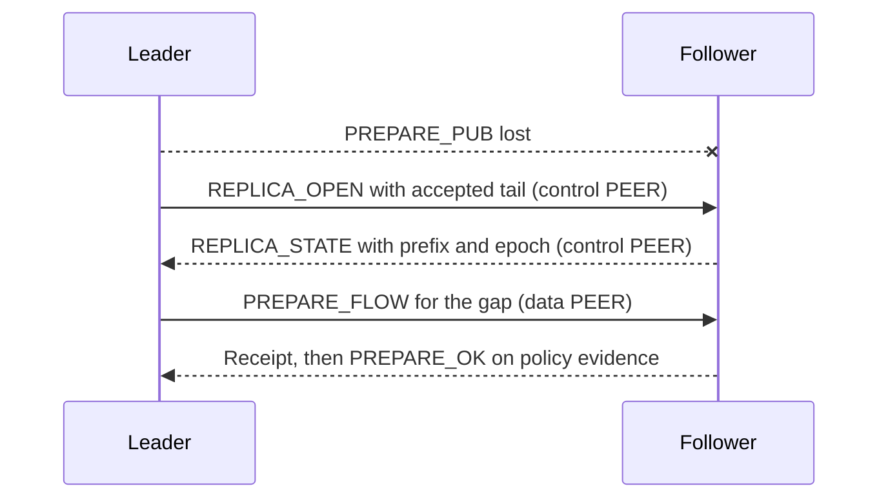
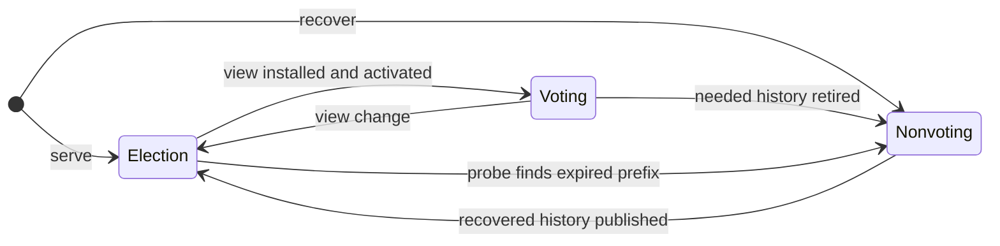

# Replication and recovery

Who may confirm a record in each mode, how leaders change, and how a broker's
partition copy restarts or recovers. For operators and contributors.
[Protocol](PROTOCOL.md) owns the wire bytes; [overview](OVERVIEW.md) owns the
terms.

## Authority

- Single durable confirms its applied local durable prefix. It has no votes,
  elections, or failover.
- Disk quorum (DQ) and replicated-persisting (RP) use three fixed brokers.
  Confirmation needs two of three eligible copies.
- A failed replicated group never becomes a single-broker group.
- Each replicated partition is its own Viewstamped Replication group, with its
  own journal, view, and policy. All three brokers store it.
- The leader of view `v` is `brokers[v % 3]` in the persisted member order.
  Only an election activates it. `init` rotates the order per partition to
  spread leaders.
- One remaining broker never confirms. There is no forced promotion, lower
  quorum, or discard of confirmed history.
- `CONFIGURATION` (256 bytes replicated, 128 bytes single durable) binds group
  identity, members and principals, policy, versions, and integrity profile.
  One mode's record never decodes as the other's.
- Missing or invalid configuration fails closed. Roll, retention, and suffix
  replacement never change membership.
- Hints, endpoints, and shard IDs grant no authority. Routing IDs need an
  independently trusted peer binding.
- Asynchronous work is fenced by configuration, view, session, receive epoch,
  and writer incarnation. Stale completions never advance state.

## Confirmation

| Rule | Disk quorum | Replicated-persisting |
| --- | --- | --- |
| Vote evidence | Durable prefix of completed `O_DSYNC` writes | Validated bytes retained in RAM |
| Leader commits through | Own durable prefix and one matching follower vote | Own retained prefix and one matching follower vote |
| Follower applies through | Announced commit, capped by its durable prefix | Announced commit, capped by its retained prefix |
| Storage deadline resets on | Durable progress | Written progress |

- The leader freezes offsets, canonical bytes, and digest before any
  asynchronous work. Followers check authority, chain, schema, application
  transition, and bounds before accepting.
- Votes are cumulative and cannot skip a predecessor or change a digest.
- Transport receipt, queued I/O, and page-cache completion are not disk votes.
  An RP vote never counts in DQ.
- The leader replies from applied state, possibly before it announces COMMIT.
  Elections preserve that history. A retry after a leader change gets its
  original result, rebuilt from canonical records.

RP persistence:

- Backing stays held through application and completed writes. A full
  backlog backpressures producers.
- Short or interrupted writes resume. Any other write, writeback, or sync
  error fences the journal, even while idle.
- A broker publishes running `MEMORY_VOTING` evidence before it votes. A clean
  shutdown closes admission, drains writes, and publishes drained evidence.
- A disk prefix cannot exclude later RAM votes. Without drained evidence a copy
  cannot vote from its disk.
- Losing every volatile copy can lose the unpersisted tail. If all three
  brokers stop uncleanly, the group stays fenced.

## Live replication

- The leader publishes each PREPARE once on PUB to both followers. There are no
  recipient masks or follower credits.
- A full leader PUB socket delays publications. Full subscriber queues and
  gaps drop them; PEER repair fills them. Follower and reader publications
  use separate backing.
- Repair uses one data PEER connection per destination shard. A full shard
  pauses only that source; control and healthy copies continue.
- If both followers stall, the unconfirmed window fills and producers see
  backpressure.

## Receipt and repair

- Followers keep only a contiguous prefix. Leader probes find gaps, including
  a lost final publication.
- Followers report PUB receipt unasked, so new work does not hurry a probe.
  COMMIT and votes go out when they change. The heartbeat and retransmit
  timers repeat them, which covers a lost packet.
- Only an answered probe starts payload repair. Repaired operations get the
  same validation as live ones.
- A receipt reports a retained prefix and cumulative bytes. It grants no vote,
  capacity, or durability.
- Receive epochs are fresh and nonzero. Reset, view change, or restart fences
  old repair; a reconnect alone keeps retained work.
- A new epoch needs a correlated probe and verified history. Counters within
  an epoch never retract or wrap.
- The leader keeps one window in flight past its announced commit. Followers
  admit only inside it, and every owner of accepted but unapplied state holds
  up to two windows.
- A receipt releases sender metadata, never bodies the receiver still needs.
  Recent repair uses a bounded cache that never waits for slow followers; older
  repair reads the journal.

## Leader change

A broker suspects the leader when contact, commit progress, or storage
progress times out. A suspicious leader stops heartbeats.

| Step | Gate |
| --- | --- |
| Suspicion | Two brokers send EXIT_VIEW for the current view |
| Promise | Stop old-view admission and replies, sync accepted history, persist the promise |
| Reports | START_VIEW_CHANGE from two brokers; DO_VIEW_CHANGE from the new leader and one other |
| Selection | Highest last normal view, then longest accepted prefix |
| Installation | Fetch and validate the selected history, install it durably, send START_VIEW |
| Activation | A new-view follower vote covers the selected tail before the leader serves |

- EXIT_VIEW is volatile suspicion, never a vote. One timeout cannot advance
  views.
- A higher durable promise fences old authority at once.
- Selection keeps every reported commit and every accepted prefix from the
  selected normal view. Only older uncertain suffixes may be dropped.
- Equal-ranked reports with different digests halt selection. Missing
  ancestry is never an empty suffix.

## Restart

- `format` creates a group. `serve` never creates missing identity or history.
- An intact reopen validates configuration, history, promises, and installed
  lineage, then enters election with a fresh writer incarnation.
- A restart never resumes old leader authority. It requests the next view or
  resumes an uninstalled promise. A promise alone grants no authority.
- An RP store needs exact drained `MEMORY_VOTING` evidence. Otherwise `serve`
  fails; recover the partition with `--quarantine`.
- Lost, rolled-back, or ambiguous stores stay nonvoting. Damage found while
  serving fails closed and never triggers automatic repair.

## Nonvoting recovery

The `recover` subcommand serves with selected partitions nonvoting. See
[getting started](../GETTING_STARTED.md) for the full command.

| Flag | Required state | Effect |
| --- | --- | --- |
| `--replace TOPIC/PARTITION` | Absent store | New store with the existing identity |
| `--quarantine TOPIC/PARTITION` | Established store | Durably drop voting eligibility, keep old files |
| `--resume TOPIC/PARTITION` | Unfinished recovery marker | Continue; allows sealed-file repair |
| `--resume-full TOPIC/PARTITION` | Unfinished recovery marker | Continue with full history transfer |

- Single-durable partitions cannot be selected.
- Authority needs fresh, nonce-scoped replies from both other brokers in
  normal operation, including the highest view's primary. Replies are not
  votes.
- The source is that primary's frozen full accepted tail. Accepted-only
  operations stay because the lost copy's pre-crash votes may confirm them.
- The copy stays nonvoting until it syncs the selected history, replays it
  privately, and publishes it atomically. A marker or checksum alone never
  restores voting.
- After publication the copy enters ordinary election, never same-view voting.
- A newer view or a stall abandons the attempt. The next one uses a fresh
  nonce.

Sealed-file repair:

- Applies only to DQ stores with damage confined to sealed segments.
  `--quarantine` and `--resume` allow it; `--resume-full` and RP stores use
  full transfer.
- Uses the same authority and donor. It reuses validated local operations but
  keeps original manifest boundaries and full private replay.
- Active-segment damage, a disagreeing donor, or a stall falls back to full
  transfer with fresh authority.

## Retained history

A copy that needs retired history withdraws into recovery instead of voting
across the gap.

- A follower told `HISTORY_RETIRED` for its next needed operation closes
  intake, quarantines itself, and recovers.
- A retained-topic restart probes the other brokers first. If both answer in
  one view and the primary's retained boundary is past the local accepted
  prefix, it persists a nonvoting marker and recovers.
- Probe replies grant no authority. An unanswered probe falls through to
  ordinary election.
- Checkpoint recovery transfers state, retained operations, and the accepted
  suffix, and validates them privately. The destination publishes its own
  checkpoint and segments before election.
- In an election, a report below the selected source's retained boundary needs
  an overlapping frozen donor whose exact tail lies in the selected lineage.
  Without it the report stays unverified.
- A broker withdraws only if its own history expired. Withdrawal aborts any
  unpublished installation; the old history and promise stay intact.

## Read authority

- Readers see only confirmed, applied records.
- Only the current leader serves SUBSCRIBE, live records, appends, and
  retries. Other brokers reject with an authority hint.
- Retention gaps are explicit errors. Readers never hold back retention.

## Limits

- Crash failures only: no Byzantine peers or reconstruction from arbitrary
  distributed corruption.
- Recovery requires both other brokers in normal operation.
- No online membership change, larger groups, partition movement, or follower
  reads.
- [Storage](STORAGE.md#supported-failure-model) defines physical failure
  assumptions.

## In the code

- `ozzy-replication/src/`: votes (`normal/`), elections (`driver/`,
  `view_change/`), recovery (`recovery/`), repair (`flow/`), single durable
  (`local.rs`).
- `ozzy-runtime/src/replica_actor/` and `replica_journal/`: actors, startup
  probe, donors, promises, installation, RP writeback.
- `ozzy-broker/src/journals/recovery.rs`: `recover` intents.
