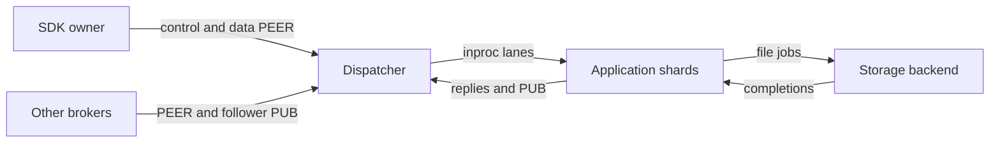

# Runtime

This page covers which thread owns what, when the SDK and broker batch and
confirm, how pressure shows up, and the deployment and telemetry settings.
[Protocol](PROTOCOL.md) owns wire layouts. [Storage](STORAGE.md) owns file
formats. [Overview](OVERVIEW.md) defines the terms.

## Threads and owners

| Thread | Count | Owns |
| --- | --- | --- |
| Dispatcher `ozzy_dispatch` | One per broker | Public sockets, sessions, routing, source pause and resume |
| OMQ I/O | `topology.omq.io_threads` per broker | Connections, framing, socket queues |
| Application shard `ozzy_app-N` | One per `topology.shards` entry | Partition actors, journals, readers, group coordinators |
| Storage backend `ozzy_io-N` | Per `controller`: `write_threads` workers plus up to two progress workers | File handles, physical jobs, buffers |
| AIO writer `ozzy_io-direct` | One per controller with `backend = "aio"` | Linux AIO submission and completion |
| SDK owner `ozzy/sdk` | One per `WriterRuntime` | Links, routing, batching, compression, retries, receipts, reader inboxes |
| SDK OMQ I/O | `OMQ_IO_THREADS` for `WriterRuntime::new` | SDK connections |

- Each thread owns its mutable state. Partition actors are tasks on a shard.
- Shards are symmetric. Shard 0 has no special duties.
- One `BrokerLinks` holds a control PEER and a data PEER across all brokers,
  plus one SUB per broker for live reads.
- Dropping an observer, such as a future or a pending record, never cancels
  admitted work.
- Deadlines use monotonic time. Append and retention timestamps use Unix time.

## Confirmation boundaries

The topic's `confirmation` value fixes when a writer gets its receipt.

| `confirmation` | Evidence before apply and reply |
| --- | --- |
| `local-durable` | Local durable prefix on the sole broker |
| `disk-quorum` | Matching durable history on the leader and one follower |
| `replicated-persisting` | Matching validated retained bytes on the leader and one follower |

- A partition applies records only after the mode's evidence exists. A
  storage wait on one partition leaves the others on the shard runnable.
- Replicated-persisting keeps record backing until it is applied and
  written. A full backlog makes APPEND admission wait.
- Replicated-persisting confirmation in RAM is not durable evidence. An
  unclean restart stays nonvoting until [recovery](REPLICATION.md).
- Group progress updates wait for the same boundary. Updates that arrive
  while a partition's progress proposal is in flight share the next one.

## Writers

- `send` waits for bounded local admission. Canceling it before admission
  assigns nothing.
- Dropping the pending record stops observation only. The record still goes
  out. `confirmed` resolves at the confirmation boundary.
- `flush` captures every record admitted before the call, even before it is
  first polled.
- `close` seals admission and confirms the captured prefix. Canceling `close`
  leaves admission sealed.
- Retries keep record identity, multipart boundaries, destination, and bytes.
  Request and session IDs may change.
- A duplicate retry is checked against the original attempt's persisted
  fingerprint, without the original payload or a dedup window. It returns
  the original offsets after the confirmation boundary.

### SDK protocol batching

Callers submit individual records. The SDK routes each record to a partition,
then batches per partition. One APPEND holds one partition.

| Rule | Behavior |
| --- | --- |
| Collection delay | None. The SDK never waits to fill a batch. |
| Nothing in flight | Ready records go at once, even a single record |
| APPEND in flight | A partial batch keeps collecting until a slot frees |
| Full batch or `flush` | Goes at once into a free APPEND slot |
| Records per APPEND | Negotiated limit, capped at 2,048 (`MAX_APPEND_RECORDS`) |
| Large record | A permitted record above the byte target goes alone |
| Keyless records | Stick to one partition until an APPEND forms, then rotate |

- Every batch is bounded by record count and bytes.
- A partial reply keeps its request slot until all its records confirm.
- Batching never changes retry identity.

`SharedTopicWriterConfig::new` sets one outstanding APPEND per partition and a
64 KiB target.

| Field | Effect |
| --- | --- |
| `batch_target_bytes` | Uncompressed grouping target |
| `inflight_appends` | Outstanding APPENDs per partition, including partial replies |
| `compress_payloads` | Adaptive whole-APPEND LZ4; turn off with `lz4+tcp://` or `zstd+tcp://` |

## Readers

[Protocol](PROTOCOL.md) owns the reader exchange and its socket planes.

| Event | Behavior |
| --- | --- |
| Subscribe | Resolve the start selector once, then read confirmed history |
| Applied end | Wait for the next append; no polling |
| Live record | Arrives over PUB; only confirmed, applied records are published |
| Gap, reconnect, or silence | Resubscribe over PEER from the next undelivered offset |
| Behind retention | Fail with `TopicReaderError::RetentionGap`; readers do not extend retention |

- PUB and PEER replay merge by offset. The reader drops duplicates.
- `TopicReaderConfig::refresh` sets how long a quiet partition waits before
  it checks for a lost final record.
- Reader ACK observes delivery, not application processing. Save a
  checkpoint only after processing.

### Consumer groups

- `GroupReader` heartbeats from the SDK owner, even while the application
  does not poll.
- Each owned partition has a processing window (`GroupReaderConfig::window`).
  A full window stops delivery for that partition only.
- Acknowledgments go out at once and advance a contiguous cursor. An
  unacknowledged record holds the cursor and is redelivered to the
  partition's next owner.
- Revocation stops delivery at once. The member keeps the partition until its
  submitted acknowledgments confirm or `GroupReaderConfig::drain` passes.
- `close` drains, then leaves, so partitions move without a membership
  timeout.
- `BrokerLinks::delete_group` is idempotent; a retry completes a failed
  delete. Readers of the deleted group stop with `GroupReaderError::Deleted`.

### Follower catch-up

Normal replication uses PUB/SUB, votes and probes use control PEER, and
bounded repair uses data PEER. [Replication](REPLICATION.md#receipt-and-repair)
owns receipt and vote evidence.

## Backpressure isolation

Transport pressure controls flow. No owner waits on a full destination while
other work is ready.

On the broker:

- Each shard has four input lanes, visited in this order: broker control,
  client control, broker data, producer data. Each visit is bounded by count
  and bytes.
- Data and control have separate shard budgets. Data cannot borrow control
  capacity.
- A full lane for a PEER input pauses that one connection. Other connections
  keep flowing. The transport carries the pause back to the sender.
- A full lane for follower PUB input drops the frame. The follower repairs
  over PEER.
- A reply to a full destination waits for that destination's send progress.
  Later replies to it keep their order. Other destinations continue.
- Dequeue frees a queue slot. Bytes return when the last payload alias drops.
- OMQ provides fairness between connections inside each socket.

On the SDK:

- `send` waits while the writer's local intake is full.
- A full live lane drops publications. The reader repairs them over PEER.
- A full replay lane pauses that broker source. Readers sharing a connection
  share that pressure. `ReaderLinkLimits` bounds both lanes.
- PUB owns separate backing and drops under pressure, so a slow consumer
  cannot pin writer memory.

## Partition scheduling

- Each partition wakes on its own events: storage completions, proposals,
  returned buffers, delivered input, and its next timer.
- A periodic safety sweep visits every partition. Work that only the sweep
  finds counts as `partition_sweep_progress`; a nonzero value means a missed
  wakeup.

## Storage backends

- Backends own file handles, buffers, admission, and execution. Shards make no
  filesystem calls.
- `backend = "aio"` uses Linux AIO for direct writes plus blocking helpers for
  other file work. `backend = "pool"` uses blocking workers for everything.
  Both keep the same contract. Ozzy does not use io_uring.
- Devices with the same `controller` share one backend and its budgets.
- Queued, running, and canceled-but-unsettled jobs stay charged. Cancellation
  never frees a running job's buffers or handles.
- Only completions that match the current journal generation advance journal
  state.
- Segment write handles stay open until roll or shutdown.
- Reader and follower replay buffers take bounded shares of the shard's
  `budget.resident_bytes`.

## Local ring exceptions

Cross-thread work uses OMQ inproc sockets, including dispatcher-shard lanes
and SDK reader inboxes. Two places use typed local queues instead:

- SDK caller lanes. Application handles pass owned Rust values (records,
  commands, receipts) to the SDK owner over bounded typed queues.
- Storage jobs. Shards submit jobs to a backend and receive completions over
  bounded rings. The backend's fixed workers share its file table.

## Shutdown and failure

- `SIGINT`, `SIGTERM`, or `Broker::shutdown` stops the dispatcher and shards.
  Shards drain accepted journal work. The backend then finishes accepted
  physical jobs and stops its workers.
- An unexpected exit of a shard or the dispatcher starts the same drain. The
  broker then reports the failure.

## Deployment configuration

One TOML file describes the whole deployment. Each broker process selects its
entry with `--broker NAME`. The [`ozzy-config` README](../ozzy-config/README.md)
owns the key reference, defaults, and validation rules; this section covers
what the keys mean at runtime.

### Endpoints

| Key in `[brokers.NAME.endpoints]` | Socket |
| --- | --- |
| `peer` | Control PEER: sessions, confirmations, subscription control |
| `data_peer` | Data PEER: APPENDs and replay |
| `reader_pub` | PUB for live consumer records |
| `follower_pub` | PUB for live follower replication; required with `mode = "three"` |

- Each endpoint is both the bind and the connect address. Schemes are
  `tcp://`, `ipc://`, and `inproc://`.
- `lz4+tcp://` and `zstd+tcp://` compress each connection on its OMQ I/O
  thread, separate from APPEND and segment compression. They need the broker
  feature `lz4-transport` or `zstd-transport`.
- A deployment compresses every endpoint or none, because a broker receives
  through one buffer profile.

### Limits

`[limits]` bounds topics, partitions, and clients. One `BrokerLinks` counts
once against `max_clients` per broker, however many readers and writers it
runs. A HELLO beyond `max_clients` is dropped, counted as
`client_limit_refusal`, and logged. The client times out.

### Topology

| Key in `[brokers.NAME.topology]` | Meaning |
| --- | --- |
| `omq.io_threads` | OMQ I/O threads |
| `dispatcher.cpu`, `dispatcher.numa_node` | Dispatcher affinity |
| `shards[].id`, `shards[].device` | Shard ID and the device it writes to |
| `shards[].affinity.cpu`, `shards[].affinity.numa_node` | Shard affinity |
| `shards[].budget.append_slots`, `.resident_bytes` | Data admission: APPENDs and retained bytes |
| `shards[].budget.control_slots`, `.control_bytes` | Control admission, separate from data |
| `memory_pools[].numa_node`, `memory_pools[].bytes` | NUMA allocation domains |
| `partitions[].topic`, `.partition`, `.shard` | Partition placement override |

- Omitting `shards` gives one shard on the sole device. Multiple devices need
  explicit shard assignments.
- CPU and NUMA values are OS IDs. NUMA placement needs an explicit CPU.

### Devices

`[brokers.NAME.devices.DEV]` sets `root` and `controller`. Devices that share a
`controller` must use identical `workers` settings.

| Key in `workers` | Meaning |
| --- | --- |
| `backend` | `aio` (Linux default) or `pool` |
| `write_threads` | Ordinary blocking workers |
| `cpus`, `progress_cpu`, `aio_cpu` | Worker CPU pinning; empty `cpus` means none |
| `aio_depth` | Kernel-outstanding direct writes |
| `max_inflight` | Ordinary physical jobs in execution |
| `queued_jobs`, `queued_bytes` | Retained ordinary jobs and bytes |
| `progress_jobs`, `progress_bytes` | Reserved progress jobs and bytes |
| `open_handles` | Open file and directory handles |

[Storage](STORAGE.md#operator-tuning) covers the tradeoffs.

## Telemetry

Telemetry is optional and off by default.

| Variable | Effect |
| --- | --- |
| `OZZY_TELEMETRY_ENDPOINT` | Publish to this OMQ endpoint, such as `ipc://@ozzy-telemetry` |
| `OZZY_BENCH_PROFILE=stages` | Stage timing without an endpoint, for benchmark tools |

- Each instrumented thread connects its own PUB socket to the endpoint. One
  external SUB collector aggregates them. Publishers share one OMQ I/O thread
  per process, independent of `OMQ_IO_THREADS`.
- Each snapshot is one JSON message with `pid`, `thread`, `thread_name`,
  `sequence`, `elapsed_ms`, `events`, `stages`, and `logs`.
- Delivery is best effort and nonblocking. Sequence gaps show lost snapshots.
- Telemetry carries no payloads, record identities, or file paths. It proves
  no confirmation.
- Fully disabled telemetry allocates nothing and reads no clock. An idle
  enabled thread adds no wakeups.
- `ozzy_telemetry::enable_counters` records events without stage timing.
  `ozzy_telemetry::totals` sums them across all threads, including exited
  ones.
- [Benchmark tools](../ozzy-bench/README.md) describe collection and event
  names.

## In the code

- Broker threads, serving, and drain: `ozzy-broker/src/frontend/`,
  `ozzy-broker/src/serving/`, `ozzy-broker/src/shards.rs`
- Dispatcher and shard lanes: `ozzy-runtime/src/frontend/`
- SDK owner, writers, readers, groups: `ozzy-runtime/src/replicated/`
- Storage backends: `ozzy-io/`, `ozzy-io-pool/`, `ozzy-io-aio/`
- Deployment schema and validation: `ozzy-config/src/`
- Telemetry: `ozzy-telemetry/src/`
