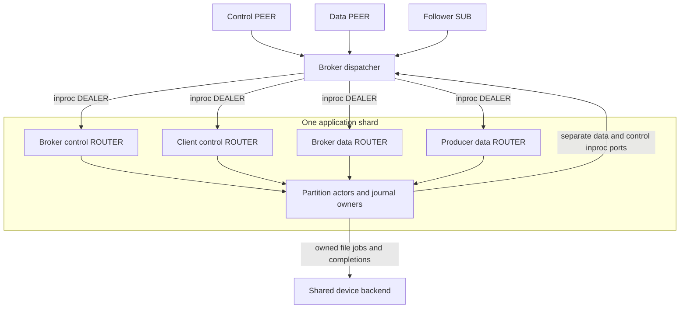
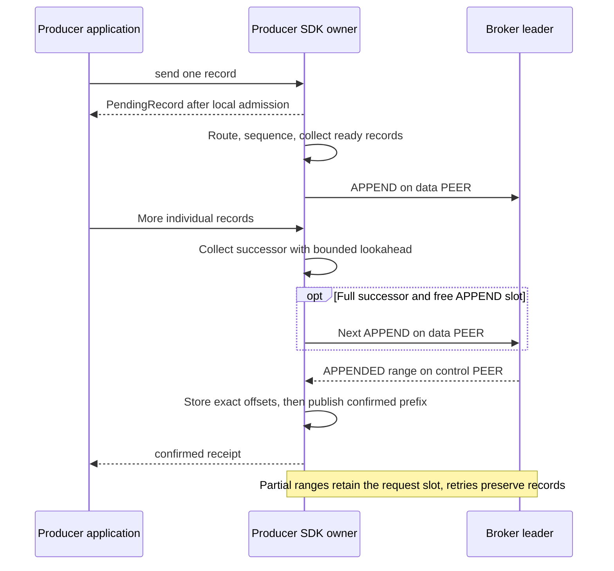
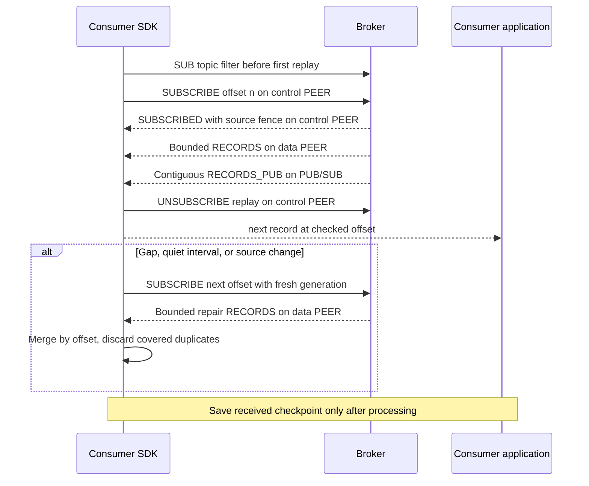

# Runtime

Each owner keeps mutable state on its own thread. OMQ carries broker/shard
messages through inproc and public traffic through PEER or PUB/SUB.
[Protocol](PROTOCOL.md) owns wire layouts; [storage](STORAGE.md) owns file order.

## Optional diagnostics

Setting `OZZY_TELEMETRY_ENDPOINT` enables the shared `ozzy-telemetry` publisher.
Each instrumented shard, SDK owner, dispatcher, and disk execution worker owns
its PUB socket and connects to that IPC endpoint. One external SUB collector
aggregates PID/thread snapshots, cumulative counters, sparse stage histograms,
and bounded logs. Disk queue and execution measurements come from backend
workers; shard-observed physical futures remain separate stages.

The publisher uses nonblocking OMQ admission and best-effort delivery. Snapshot
and log sequences expose loss. Each thread retains at most sixteen log entries
of 256 UTF-8 bytes each. Each PUB queue admits at most eight snapshots.
Publishers share one process-wide OMQ context with exactly one I/O thread,
independent of `OMQ_IO_THREADS`. Each emitter publishes during work or logging,
at most once per 20 ms, plus a final snapshot on thread exit. Work reads the clock
once per 64 recorded operations, so a quiet emitter publishes less often. An idle
emitter adds no periodic wakeup. Without an endpoint or stage profiling, diagnostics allocate no local
telemetry state and read no clock.
Telemetry carries no payloads, record identities, or file paths and proves no
confirmation. [Benchmark tools](../ozzy-bench/README.md) describe collection.

## Deployment configuration

TOML binds broker identities, immutable topic partitions/membership, local shard
placement, device roots/backends, and public endpoints. Each broker binds one
control PEER, data PEER, reader PUB, and optional follower PUB.

Endpoints use `tcp://`, `ipc://`, or `inproc://`. The compressed schemes
`lz4+tcp://` and `zstd+tcp://` (features `lz4-transport` and `zstd-transport`)
compress each connection on its OMQ I/O thread, independent of APPEND and
segment compression. A deployment compresses every endpoint or none, because
each broker receives through one buffer profile.

## OMQ ownership and scheduling

| Owner | Execution and state |
| --- | --- |
| Dispatcher | Separate thread; sockets, sessions, routing, source pause/resume |
| Application shard | OS thread/current-thread runtime; partition actors, journals, readers |
| Producer SDK owner | Current-thread runtime; sequence order, packing, retry, receipts |
| Consumer SDK role | Separate subscriptions, offsets, replay/live merge, processing observations |
| OMQ I/O worker | Network runtime; framing, connections, socket queues |
| AIO device owner | One thread/device; direct-write submission/completion |
| Device helpers / pool | Fixed blocking workers; file operations and reserved progress |

Actors are tasks, not threads. Shard 0 has no special duties; actors call journals
directly. The broker defaults to one dispatcher and one OMQ I/O worker.

Four input lanes and separate data/control output ports have count/byte bounds.
Completion IDs remain in a bounded owner table. Dropping observers does not
cancel admitted work.

`BrokerLinks` shares SDK session/transport code: two PEER sockets across all
brokers, plus one SUB/broker for live readers. Discovery returns the first
complete validated catalog under one deadline. Pages keep one donor; replacement
sessions restart at page zero and fence late replies.

Each producer driver owns and drains its APPEND reply receiver. Readiness waits
do not consume replies; retained frame leases still hold admission until release.
APPEND correlations stay in SDK-thread state on its local executor. Logical
writers and physical-link drivers access that same owner directly. Route reads
use immutable observations published per partition, filtered against current
physical sessions. Cache mutation and registration retain cold-path locks.

Each consumer subscription uses separate bounded OMQ inproc PAIR lanes for
replay and live frames, sharing the SDK's transport context. Queue slots return
on dequeue; payload aliases retain independent backing admission. A full live
lane drops publications for PEER gap repair. A full replay lane pauses its
physical source. Rejections have separate reserved storage. Packet routing and
subscription selections read immutable published snapshots.

Deadlines use monotonic time; append/retention timestamps use Unix time.
Simulation clocks control both independently of storage execution/completion.

## Confirmation boundaries

| Mode | Required evidence before apply/reply |
| --- | --- |
| Single-broker durable | Local durable prefix |
| Disk quorum | Matching durable history on leader and one follower |
| Replicated-persisting | Matching validated retained bytes on leader and one follower |

Group-progress service queries return applied cursors while newer writes are
pending. Cumulative updates wait for their captured prefix under the mode policy.
A partition has one progress proposal in flight. Updates that arrive meanwhile
wait, then share the next proposal, one operation per group cursor and up to 16
or the replication packet bound. Each update keeps its own reply. An update
that repeats an accepted cursor needs no operation; the proposal's commit covers
it. If any shared update is invalid, every update in that proposal validates
again on its own.
Source ownership changes use the same proposal pipeline. The source allocates
the assignment epoch and fills the resume cursor from accepted progress; only a
confirmed assignment authorizes activation. Retrying the same plan returns its
captured cursor and epoch, even after newer progress. Stale plans, changed
owners, and delayed acknowledgments are fenced.

### Replicated confirmation with background persistence

RP retains backing until application and physical writing permit release;
a full backlog backpressures admission. Unclean restart stays nonvoting until
recovery. RAM confirmation supplies no durable-prefix evidence.

Donor pinning waits for captured writes and its independent barrier, then freezes
one source per recovery nonce. Repeated requests reuse that snapshot. Link loss,
nonce replacement, or view change invalidates the exchange; late completions
cannot overwrite a newer response or recapture a moving tail under an old nonce.
Busy history reads keep the original correlated request available for retry.

### Local durable pipeline

Validation assigns offsets and freezes operations. The journal prepares groups,
installs ordered writes, publishes durable evidence, then applies records.
Storage waits leave other partitions runnable; a backing-blocked ready batch
keeps its position when capacity returns.

## Writer API

`send` observes local admission; `confirmed` and `flush` observe broker policy.
Flush captures a sequence end. Request/session IDs may change on retry; record
identity, multipart boundaries, destination, and bytes remain fixed.
Resume/takeover resolves every partition before admission and keeps a stable
transition ID across response retries. Route hints never grant authority.

Stored retries compare retained record bytes. Duplicate retries verify the
original attempt's persisted fingerprint, including identity, encoding, multipart
boundaries, and bytes. They do not require the original event's payload or a live
dedup window. Retiring producer results expires that retry evidence. Resolving a
retry returns its original operation prefix; replies still wait for the mode's
confirmation boundary.

### SDK protocol batching

| Bound | Contract |
| --- | --- |
| Records/APPEND | Negotiated limit, capped at 2,048 |
| Default payload target | 64 KiB; a permitted larger record goes alone |
| Default outstanding APPENDs | One per partition writer; configurable |
| Collection delay | None; collect ready work |
| Intake reservation | Payload/part tables, including empty parts, plus one lookahead record |

A full successor pipelines behind outstanding APPENDs; partial replies retain
the request slot. Payload, metadata, record, and part limits remain independent.

Payloads up to 128 bytes remain inline during intake/packing. Receipts use
16-cell pages containing identities/offsets, no payloads. Offset stores precede
confirmed-prefix release publication; callers acquire the prefix before reading.
Packing returns inbox slots, confirmation releases retry state, and final
transport aliases release backing. All remain separately charged.

## Readers

| Event | Behavior |
| --- | --- |
| SUBSCRIBE | Resolve selector once; open indexed confirmed-history cursor |
| Applied end | Park until append, source change, or buffer release |
| Reconnect / PEER gap | Resume next undelivered offset; gaps use a fresh subscription generation |
| Full SDK inbox | Retain frame and pause exact source; connection-sharing readers share pressure |
| SUBSCRIBED / UNSUBSCRIBED | Become bounded cursor completions before releasing raw control admission |
| Detached cancellation | Keep original session; disconnect/replacement settles locally; a lost original-session reply times out |

RECORDS uses data PEER; subscription, cancellation, ACK, and NACK use control.
Idle readers cannot pin producer control capacity. Readers do not extend
retention; ACK observes volatile delivery, not durable application processing.

Validation under owner-memory pressure retains unadmitted proposals and received
canonical suffixes. Retries wait for the complete failed working set's byte and
buffer capacity, including scratch and replacements released on deferral. Other
partitions and physical completions remain runnable on the shard.

Processing windows retain delivered offsets until broker confirmation. Completed
records advance only a contiguous exclusive cursor; dropped tokens leave holes.
Submitting an acknowledgment wakes one SDK source owner through a monotonic
cursor. It sends ready progress immediately over existing broker links; records
completed during an outstanding request share the next cumulative request.
Neither reader polling nor per-record tasks drive confirmations.
The unique confirmation owner seals the prefix on failure. Tokens and waiters
retain their metadata charge until the final alias is released.
Closing the window or aborting its owner releases unconfirmed waiters. An already
admitted broker write may still finish; sealed observations never reopen.

`BrokerLinks::group_progress` uses existing control sockets and requires progress
negotiation. Replies validate the complete source assignment and release raw
control admission before the caller resumes. Lost replies retry cumulatively;
expired resumes and fenced assignments are typed errors.

`GroupReader` joins a named group on the topic's coordinator partition. A
background task on the SDK owner sends join and heartbeat requests listing the
instance's owned sources, and relays each activatable target to its source
leader. Each activated source gets one processing window and a reader cursor at
the captured start. Full windows gate delivery for that source only. Revocation
stops delivery at once; the source stays reported as owned until its submitted
acknowledgments confirm or the local drain bound passes, so its next owner
starts at the confirmed cursor. `close` drains, then leaves, so sources move
without a membership timeout. Membership owns the drain deadlines and computes
the owned list from read-only progress observations, even while the application
does not poll. Source confirmations, terminal results, and membership changes
share one generation wakeup; record delivery builds no vector of boxed waits.
The processing metadata budget reserves two windows per partition, each charged
for its completion slots, window structure, shared progress structure, and Arc
allocation header. Token aliases retain their shared charge after revocation.
Activation retries use their own bounded backoff timer, independent of the
heartbeat interval. Membership and progress classify transport failures and
retry hints with the same helper.
A fenced or unknown instance rejoins with a fresh join ID. Old tokens remain
fenced; new source windows resume from broker-confirmed cursors. Join requests
name the incarnation the reader first joined, so a reader of a deleted group
stops with `GroupReaderError::Deleted` instead of creating a new incarnation.

`BrokerLinks::inspect_group` returns a group's committed coordinator image.
`BrokerLinks::delete_group` revokes the incarnation on every source leader at
plan revision `u64::MAX`, which fences its activations and progress, then
retires the coordinator image. Each step is idempotent, so retrying a failed
deletion completes it. A new reader with the same name starts a new incarnation
at its creation selector.

### Live reader publication

PUB contains only confirmed applied records. Consumers verify source/offsets,
merge overlaps, and repair gaps or quiet final loss over PEER. PUB drops under
pressure and owns separate encoded backing, so slow consumers cannot pin writer
arenas. Consumer checkpoints require application persistence.

## Follower catch-up

Normal replication uses PUB/SUB; votes/probes use control PEER; bounded targeted
repair uses data PEER. Repair aliases identify destination shards without
replacing control sessions. [Replication](REPLICATION.md#receipt-and-repair)
owns receipt epochs, history validation, and vote evidence.

## Backpressure isolation

Shards visit broker control, client control, broker data, then producer data in
bounded turns. Each input holds at most one separately charged deferred frame.
Full PEER destinations return the frame to its exact OMQ source and pause it;
full PUB intake drops. The dispatcher never waits for a full destination.
It transmits one queued frame before admitting each shard command, so refused
commands cannot starve the queues they wait on. A shard's replies to one
destination class leave in the order the shard produced them: the shard hands
them over in that order, and a reply the dispatcher refused for capacity holds
the destination's later replies until the shard re-submits it. A destination OMQ refused is
retried only after it reports send progress. Progress the retry cannot use
delays that class's next wait by 1 ms, doubling to 8 ms, until a frame is sent.
Paused-source retry turns allow 16 attempts or 2 MiB, with one indivisible-frame
exception. OMQ supplies connection fairness inside each socket.

Dequeue releases slots; final aliases release bytes. All partition actors share
shard budgets. Lifecycle events are drained before native dequeue; each body is
admitted synchronously before observing another disconnect/replacement. Exact
connection IDs fence late teardown; OMQ fences queued generations and retired
receive sources. Ozzy admission does not query transport liveness.

## Disk workers

### Async storage

Backends own handles, buffers, admission, and execution. Shards install ordered,
generation-matching completions without filesystem calls. Queued, running, and
canceled-but-unsettled jobs remain charged. One AIO owner/device uses fixed file
helpers and reserved progress; the pool backend obeys the same contract.

Frontend/shards share one shutdown request and the first failure, with separate
completion state. Failure is published before queues and sockets close.
Both observe shutdown before lanes close; unexpected service-time closure is
fatal. Shutdown drains journals, transport, and backend workers.

Write handles survive until roll/shutdown. A four-entry read-handle LRU drops
only cache leases; running reads keep handles and selected-file protection.

### Local ring exceptions

SDK caller lanes and backend jobs/completions use typed owned rings and local
signals. Broker/shard commands use OMQ inproc. The backend handle registry is
shared by fixed workers; blocking journal APIs serve offline work only.

Broker recent-read allowances divide at most one third of shard memory across
journals, with up to 2 MiB/journal for compact indexes. Follower replay uses a
separate one-eighth share, at least one append pipeline; oversized packets bypass
it. Whole backing allocations remain charged, including compressed aliases.
