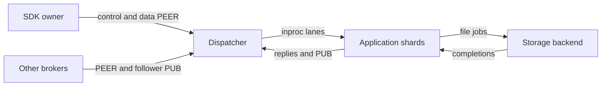

# Runtime

This page covers which thread owns what, when the SDK and broker batch and
confirm, how pressure shows up, and the deployment and telemetry settings.
[Protocol](PROTOCOL.md) owns wire layouts. [Storage](STORAGE.md) owns file
formats. [Overview](OVERVIEW.md) defines the terms.

## Threads and owners

| Thread | Count | Owns |
| --- | --- | --- |
| Dispatcher `ozzy/dispatch` | One per broker | Public sockets, sessions, routing, source pause and resume |
| OMQ I/O `ozzy/omq/IO/N` | `topology.omq.io_threads` per broker | Connections, framing, socket queues |
| Shard `ozzy/shard/N` | One per `topology.shards` entry | Partition actors, journals, readers, group coordinators |
| Disk worker `ozzy/disk/N` | `write_threads` per `controller` | Segment data writes; with `aio`, only those without `O_DIRECT` |
| Disk progress worker `ozzy/disk/pN` | Up to two per `controller` | Syncs, reads, opens, directory listings, metadata; never queued behind segment data |
| AIO writer `ozzy/disk/aio` | One per controller with `backend = "aio"` | Linux AIO submission and completion |
| Admin owner `ozzy/admin` | One per broker with an `admin` endpoint | Admin endpoint; asks shards for partition status, reads counters and links, deletes consumer groups |
| SDK owner `ozzy/sdk` | One per `WriterRuntime`; one in a broker after its first admin group deletion | Links, routing, batching, compression, retries, receipts, reader inboxes |
| SDK OMQ I/O | `OMQ_IO_THREADS` for `WriterRuntime::new` | SDK connections |

- Each thread owns its mutable state. Partition actors are tasks on a shard.
- Shards are symmetric. Shard 0 has no special duties.
- One `BrokerLinks` holds a control PEER and a data PEER across all brokers,
  plus one SUB per broker for live reads.
- Dropping an observer, such as a future or a pending record, never cancels
  admitted work.
- Deadlines use monotonic time. Append and retention timestamps use Unix time.

## Confirmation boundaries

`cluster.mode` fixes when a writer gets its receipt.

| `cluster.mode` | Evidence before apply and reply |
| --- | --- |
| `single` | Local durable prefix on the sole broker |
| `three` | Matching durable history on the leader and one follower |

- A partition applies records only after the mode's evidence exists. A
  storage wait on one partition leaves the others on the shard runnable.
- Group progress updates wait for the same boundary. Updates that arrive
  while a partition's progress proposal is in flight share the next one.

## Writers

- `send` waits for bounded local admission. Canceling it before admission
  assigns nothing.
- `send_to_partition(record, number)` uses the same admission path for an
  exact zero-based numeric partition. Unknown numbers fail before admission
  or sequence assignment. It never hashes or falls back to another partition.
- Dropping the pending record stops observation only. The record still goes
  out. `confirmed` resolves at the confirmation boundary.
- A waiting `confirmed` wakes only when its own record confirms or the writer
  fails. Simultaneous observers of one record share the per-confirmation
  broadcast that `flush` uses.
- `flush` captures every record admitted before the call, even before it is
  first polled.
- `close` seals admission and confirms the captured prefix. Canceling `close`
  leaves admission sealed.
- Retries keep record identity, multipart boundaries, destination, and bytes.
  Request and session IDs may change.
- A duplicate retry is checked against the original attempt's persisted
  fingerprint, without the original payload or a dedup window. It returns
  the original offsets after the confirmation boundary.

### SDK protocol batching

Callers submit individual records. The SDK routes each record to a partition,
then batches per partition. One APPEND holds one partition.
Explicit, keyed, and keyless writes to the same partition share sequences,
batches, and limits. Explicit sends do not select a sticky partition; their
formed APPENDs still drive the usual keyless rotation.

| Rule | Behavior |
| --- | --- |
| Collection delay | None. The SDK never waits to fill a batch. |
| Nothing in flight | Ready records go at once, even a single record |
| APPEND in flight | A partial batch keeps collecting until a slot frees |
| Full batch or `flush` | Goes at once into a free APPEND slot |
| Records per APPEND | Negotiated limit, capped at 2,048 (`MAX_APPEND_RECORDS`) |
| Large record | A permitted record above the byte target goes alone |
| Keyless records | Stick to one partition until an APPEND forms, then rotate |

- Every batch is bounded by record count and bytes.
- A partial reply keeps its request slot until all its records confirm.
- Batching never changes retry identity.

`SharedTopicWriterConfig::new` sets one outstanding APPEND per partition and a
64 KiB target.

| Field | Effect |
| --- | --- |
| `batch_target_bytes` | Uncompressed grouping target |
| `inflight_appends` | Outstanding APPENDs per partition, including partial replies |
| `compress_payloads` | Adaptive whole-APPEND LZ4; turn off with `lz4+tcp://` or `zstd+tcp://` |

## Python bindings

`bindings/python` delegates log operations to `ozzy`'s `BrokerLinks`,
`SharedTopicWriter`, and `TopicReader`. Both Python APIs share those Rust
implementations and the existing owned SDK runtime. Python adds input conversion,
typed values, context managers, and interpreter scheduling only.

Python `ClientConfig.compression` maps `lz4` (the default) and `raw` directly
to `SharedTopicWriterConfig.compress_payloads`. Adaptive packing, fallback,
and decoding remain in Rust. Python wheels include OMQ LZ4 transport support;
endpoint schemes select transport compression independently of APPEND packing.
`reader_queue_messages` defaults to 32 and accepts 1 through 64. The Rust
reader reservation charges its queues and retained aliases before opening.
Producer `max_records` and `max_parts` do not limit inbound publications.
`reader_max_records` and `reader_max_parts` independently bound receive frames,
defaulting to 2,048 each; receive reservations use these bounds. Raw broker
publications may combine more records than any one producer APPEND.

Ready blocking sends, receives, and confirmations poll inline with a cached
caller waker; waiting releases the GIL, remains interruptible, and accepts a
timeout that cancels the SDK future. Native awaitables poll SDK futures from
asyncio and implement the coroutine protocol. Their wakers never take the GIL:
a woken task queues itself and signals one socket per event loop, whose reader
resolves every queued asyncio future in one pass. SDK and transport threads
therefore never wait for Python. Lifecycle awaitables poll and drop with the
GIL released because dropping SDK owners joins threads.
The asyncio facade probes Rust admission, ready records, and confirmations
directly; it creates a native awaitable only when the operation would wait.
An admission probe that cannot proceed assigns no sequence and retains no input.
An exclusive lease moves a mutable SDK handle out of its Python object for any
operation that may wait, blocking or asyncio, then returns it on completion,
timeout, or cancellation. Other operations borrow the handle only for Rust
work that runs no Python code, so a lease dropped by garbage collection always
finds its owner unborrowed. `SyncWrapper` requires exclusive Rust access
without a mutex. Concurrent operations on a leased handle raise `BusyError`;
immutable receipt observers may run together. A flush captures its prefix,
then waits without a lease. Producer and consumer opens clone the client's
shared links and wait without its lease, so threads and tasks may open handles
concurrently; connect and close lease the client. SDK admission, identity, retry, checkpoint, and
close semantics remain owned by the Rust implementation.
Native handle destruction releases the GIL while dropping Rust state.
Owners record the process's fork generation, advanced by
`os.register_at_fork`; a child rejects and never drops inherited owners.
`bytes` inputs copy directly into Rust SDK storage, keeping small records
inline; other buffers are copied once and their storage moves into admission.
Receipts retain native IDs and format only requested properties. Records copy
payload parts into Python bytes on delivery, so retained records hold no
receive frame.
Python `Consumer.stats()` exposes the Rust reader's live deliveries, replayed
records, and live gap transitions, including its final counters after close.

## Java bindings

`bindings/java` calls the same `BrokerLinks`, `SharedTopicWriter`, and
`TopicReader` as Python. Both bindings construct checked reservations through
`bindings/common`. JNI handles lifecycle, multipart conversion, and async setup;
FFM polls ready single-buffer admission, reads, and confirmations directly.
Java adds no network queues, protocol codecs, retry state, or batching worker.

Java atomically leases one mutable native handle per operation. JNI moves its
owned box into a Rust SDK future and restores it before returning the lease.
A flush captures its prefix during the call and waits without the lease.
Producer and consumer opens clone the client's shared links during the call,
so concurrent opens on one client proceed.
One fixed binding executor polls waiting futures; it owns no transport state.
Client close joins SDK and transport threads on a blocking thread, never on
that executor. Cancellation waits for lease return. If Rust already produced a
result, cancellation loses and the future delivers it, preserving reader
progress. Timeouts cancel on the common pool, so a lease wait never stalls a
shared timer thread. Close seals admission before waiting, and canceled closes
remain sealed.

Native callbacks prepare values and release leases before completing Java
futures. A result produced during the starting call completes inline, before
any continuation exists; a blocking waiter completes its own future; other
completions run on the common pool. User callbacks never execute on SDK owner
or binding executor threads. A native operation that ends without a result,
such as a failed delivery, completes exceptionally. Pending confirmations are
immutable shared observers; reachability fences prevent their native storage
from being reclaimed during concurrent calls. Explicit close cleans mutable
handles; Cleaner is their leak fallback.
Each pending handle is one strong count of the Rust observer. Handles share one
Cleaner registration per group of at most 64 admissions, released in one
native call. The producer's existing lease serializes group construction;
each observer keeps its group reachable during native calls. Group cleanup
owns each handle exactly once. One retained observer can retain up to 64 native
observation handles, never their payloads. Closing the producer drops its
current group reference without invalidating surviving observers.

FFM copies single inputs directly into Rust SDK storage; multipart inputs pack
into one Java array copied once into native storage. Receive calls expose
payload views only while Java holds the consumer lease; Java copies them before
returning an immutable record. Native receive backing remains bounded to one
cached record, and no native payload pointer escapes. UUIDs remain two integers
until requested, and unsigned offsets/epochs retain their bits in Java longs.
Scalar failures use caller-owned output storage, including on virtual threads.

## Readers

[Protocol](PROTOCOL.md) owns the reader exchange and its socket planes.

| Event | Behavior |
| --- | --- |
| Subscribe | Resolve the start selector once, then read confirmed history |
| Applied end | Wait for the next append; no polling |
| Live record | Arrives over PUB; only confirmed, applied records are published |
| Gap, reconnect, or silence | Resubscribe over PEER from the next undelivered offset |
| Behind retention | Fail with `TopicReaderError::RetentionGap`; readers do not extend retention |

- PUB and PEER replay merge by offset. The reader drops duplicates.
- A reader's SUB joins a partition's live topic once the broker replies
  SUBSCRIBED, which admits it. Going live cancels only the replay stream, so
  the grant and the SUBSCRIBE stay. An acceptance after a reset or a quiet
  refresh renews the SUBSCRIBE, which the broker may have refused or revoked
  meanwhile; a replay that repairs a gap keeps it. The SUB cancels the topic
  once the subscription ends, before the broker closes a connection that
  keeps it.
- `TopicReaderConfig::refresh` sets how long a quiet partition waits before
  it checks for a lost final record.
- Reader ACK observes delivery, not application processing. Save a
  checkpoint only after processing.

### Consumer groups

- `GroupReader` heartbeats from the SDK owner, even while the application
  does not poll.
- Each owned partition has a processing window (`GroupReaderConfig::window`).
  A full window stops delivery for that partition only.
- Acknowledgments go out at once and advance a contiguous cursor. An
  unacknowledged record holds the cursor and is redelivered to the
  partition's next owner.
- Revocation stops delivery at once. The member keeps the partition until its
  submitted acknowledgments confirm or `GroupReaderConfig::drain` passes.
- `close` drains, then leaves, so partitions move without a membership
  timeout.
- `BrokerLinks::delete_group` is idempotent; a retry completes a failed
  delete. Readers of the deleted group stop with `GroupReaderError::Deleted`.

### Follower catch-up

Normal replication uses PUB/SUB, votes and probes use control PEER, and
bounded repair uses data PEER. [Replication](REPLICATION.md#receipt-and-repair)
owns receipt and vote evidence.

## Backpressure isolation

Transport pressure controls flow. No owner waits on a full destination while
other work is ready.

On the broker:

- Each shard has four input lanes, visited in this order: broker control,
  client control, broker data, producer data. Each visit is bounded by count
  and bytes.
- Data and control have separate shard budgets. Data cannot borrow control
  capacity.
- A full lane for a PEER input pauses that one connection. Other connections
  keep flowing. The transport carries the pause back to the sender.
- A full lane for follower PUB input drops the frame. The follower repairs
  over PEER.
- A full PUB socket keeps its refused frame until OMQ reports space. That
  socket takes no other frame meanwhile, so the shards behind it hold
  intake. Inside OMQ a slow subscriber still loses frames and repairs over
  PEER.
- A reply to a full destination waits for that destination's send progress.
  Later replies to it keep their order. Other destinations continue.
- Dequeue frees a queue slot. Bytes return when the last payload alias drops.
- OMQ provides fairness between connections inside each socket.

On the SDK:

- `send` waits while the writer's local intake is full.
- A full live lane drops publications. The reader repairs them over PEER.
- A full replay lane pauses that broker source. Readers sharing a connection
  share that pressure. `ReaderLinkLimits` bounds both lanes.
- PUB owns separate backing and drops under pressure, so a slow consumer
  cannot pin writer memory.

## Partition scheduling

- Each partition wakes on its own events: storage completions, proposals,
  returned buffers, delivered input, and its next timer.
- A shard turn delivers input first, then visits the marked partitions.
  A visit repeats, up to four rounds, while the partition makes progress or
  wakes itself, instead of waiting for later turns.
- Freed reply slots and returned port capacity wake the shard only after a
  send was refused.
- A periodic safety sweep visits every partition. Work that only the sweep
  finds counts as `partition_sweep_progress`; a nonzero value means a missed
  wakeup.
- A partition with held scheduled records wakes when the earliest
  committed one is due, by the journal clock.

### Release steps

Only the leader releases, one step at a time.

- The owner picks the due records from its held index.
- A detached job reads their `Schedule` or `Carry` operations beside writes.
- The `Release` waits for pipeline room, then validates before queued
  producer requests. In disk quorum it also waits for a free live slot,
  since it holds no ingress permit.
- The next step starts once this `Release` commits. Under load, each step
  takes more records.
- A step fills at most one proposal arena from at most 64 operations. It
  waits for shard memory when none is free.
- Each delay partition keeps up to 4 MiB of held operation bodies in
  memory, so most steps read no storage.
- Held state also keeps where up to 65536 held operations per partition
  were written. Steps read those there, in the detached job.
- Other operations, as after a restart or a pack, are read through a
  journal index snapshot. Steps reuse it while it covers their operations.
  It pins its segments until the next build or storage cleanup.
- With no sealed held record loaded, a step loads the next ones from the
  sealed indexes. The next step starts at once.
- Loads read only sealed indexes this owner validated, with no scan of the
  active segment. They reuse the opened indexes until a segment seals or
  retires, or storage cleanup runs.
- A follower loads the same way when a `Release` passes held rows it has
  not loaded.
- A due retention turn goes first.
- A step that builds nothing, or is not admitted, waits 10 ms. A refused
  one waits 100 ms.
- A leader's retention turn can name a carry target. Steps then carry held
  rows up to it, in position order, into one `Carry` per step. A `Carry` is
  timestamped at validation. Carrying and releasing alternate.

## Storage backends

- Backends own file handles, buffers, admission, and execution. Shards make no
  filesystem calls.
- `backend = "aio"` uses Linux AIO for direct writes plus blocking helpers for
  other file work. `backend = "pool"` uses blocking workers for everything.
  Both keep the same contract. Ozzy does not use io_uring.
- Devices with the same `controller` share one backend and its budgets.
- Queued, running, and canceled-but-unsettled jobs stay charged. Cancellation
  never frees a running job's buffers or handles.
- Only completions that match the current journal generation advance journal
  state.
- Segment write handles stay open until roll or shutdown.
- Reader and follower replay buffers take bounded shares of the shard's
  `budget.resident_bytes`.

## Local ring exceptions

Cross-thread work uses OMQ inproc sockets, including dispatcher-shard lanes
and SDK reader inboxes. Two places use typed local queues instead:

- SDK caller lanes. Application handles pass owned Rust values (records,
  commands, receipts) to the SDK owner over bounded typed queues.
- Storage jobs. Shards submit jobs to a backend and receive completions over
  bounded rings. The backend's fixed workers share its file table.

## Shutdown and failure

- `SIGINT`, `SIGTERM`, or `Broker::shutdown` stops the dispatcher and shards.
  Shards drain accepted journal work. The backend then finishes accepted
  physical jobs and stops its workers.
- An unexpected exit of a shard or the dispatcher starts the same drain. The
  broker then reports the failure.

## Deployment configuration

One TOML file describes the whole deployment. Each broker process selects its
entry with `--broker NAME`. The [`ozzy-config` README](../ozzy-config/README.md)
owns the key reference, defaults, and validation rules; this section covers
what the keys mean at runtime.

### Endpoints

| Key in `[brokers.NAME.endpoints]` | Socket |
| --- | --- |
| `peer` | Control PEER: sessions, confirmations, subscription control |
| `data_peer` | Data PEER: APPENDs and replay |
| `reader_pub` | PUB for live consumer records |
| `follower_pub` | PUB for live follower replication; required with `mode = "three"` |
| `admin` | Optional PEER for the [admin console](PROTOCOL.md#admin-console); `ipc://` or `inproc://` only, no authentication |

- Each endpoint is both the bind and the connect address. Schemes are
  `tcp://`, `ipc://`, and `inproc://`.
- `lz4+tcp://` and `zstd+tcp://` compress each connection on its OMQ I/O
  thread, separate from APPEND and segment compression. They need the broker
  feature `lz4-transport` or `zstd-transport`.
- A deployment compresses every endpoint or none, because a broker receives
  through one buffer profile.

### Limits

`[limits]` bounds topics, partitions, and clients. One `BrokerLinks` counts
once against `max_clients` per broker, however many readers and writers it
runs. A HELLO beyond `max_clients` is dropped, counted as
`client_limit_refusal`, and logged. The client times out.

### Topology

| Key in `[brokers.NAME.topology]` | Meaning |
| --- | --- |
| `omq.io_threads` | OMQ I/O threads |
| `omq.ingress.bytes_per_second`, `.burst_bytes` | Aggregate incoming network rate and burst |
| `omq.egress.bytes_per_second`, `.burst_bytes` | Aggregate outgoing network rate and burst |
| `dispatcher.cpu`, `dispatcher.numa_node` | Dispatcher affinity |
| `shards[].id`, `shards[].device` | Shard ID and the device it writes to |
| `shards[].affinity.cpu`, `shards[].affinity.numa_node` | Shard affinity |
| `shards[].budget.append_slots`, `.resident_bytes` | Data admission: APPENDs and retained bytes |
| `shards[].budget.control_slots`, `.control_bytes` | Control admission, separate from data |
| `memory_pools[].numa_node`, `memory_pools[].bytes` | NUMA allocation domains |
| `partitions[].topic`, `.partition`, `.shard` | Partition placement override |

- Omitting `shards` gives one shard on the sole device. Multiple devices need
  explicit shard assignments.
- CPU and NUMA values are OS IDs. NUMA placement needs an explicit CPU.

### Network byte limits

Each optional direction sets positive `bytes_per_second` and `burst_bytes`.
Omission disables that direction. Buckets start full and refill up to the burst;
exhaustion backpressures transport I/O. Changes take effect on broker restart.

OMQ owns one allowance per broker context, shared across every socket and I/O
thread. All network traffic on that context counts, including control, readers,
replication, and repair. Accounting uses transport bytes after framing and
compression; each PUB subscriber copy counts separately. TCP setup and lower
network-layer overhead are exempt, as are IPC, inproc, and SHM.

Embedded brokers sharing an injected OMQ context share its allowance. Configure
limits before its first socket, or supply a context whose limits already match
the broker plan. Startup rejects conflicting active contexts.

### Devices

`[brokers.NAME.devices.DEV]` sets `root` and `controller`. Devices that share a
`controller` must use identical `workers` settings.

| Key in `workers` | Meaning |
| --- | --- |
| `backend` | `aio` (Linux default) or `pool` |
| `write_threads` | Ordinary blocking workers |
| `cpus`, `progress_cpu`, `aio_cpu` | Worker CPU pinning; empty `cpus` means none |
| `aio_depth` | Kernel-outstanding direct writes |
| `max_inflight` | Ordinary physical jobs in execution |
| `queued_jobs`, `queued_bytes` | Retained ordinary jobs and bytes |
| `progress_jobs`, `progress_bytes` | Reserved progress jobs and bytes |
| `open_handles` | Open file and directory handles |

[Storage](STORAGE.md#operator-tuning) covers the tradeoffs.

## Telemetry

Event counters always count, per thread. Stage timing and PUB snapshots are
optional and off by default.

| Variable | Effect |
| --- | --- |
| `OZZY_TELEMETRY_ENDPOINT` | Publish to this OMQ endpoint, such as `ipc://@ozzy-telemetry` |
| `OZZY_BENCH_PROFILE=stages` | Stage timing without an endpoint, for benchmark tools |

- Each instrumented thread connects its own PUB socket to the endpoint. One
  external SUB collector aggregates them. Publishers share one OMQ I/O thread
  per process, independent of `OMQ_IO_THREADS`.
- Each snapshot is one JSON message with `pid`, `thread`, `thread_name`,
  `sequence`, `elapsed_ms`, `events`, `stages`, and `logs`.
- Delivery is best effort and nonblocking. Sequence gaps show lost snapshots.
- Telemetry carries no payloads, record identities, or file paths. It proves
  no confirmation.
- A counter update is a relaxed store to a thread-owned atomic. Without stage
  timing or an endpoint, no path reads the clock. An idle enabled thread adds
  no wakeups.
- `ozzy_telemetry::totals` sums the counters across all threads, including
  exited ones. `ozzy_telemetry::threads` lists them by thread; the admin
  endpoint serves both.
- `ozzy_telemetry::log` always keeps the process's last 64 diagnostics for
  `ozzy_telemetry::recent_logs`, which the admin endpoint serves. Publishing
  them stays optional. Logging is rare, so one lock guards that list.
- `io_failed` counts storage errors. An open, metadata, remove, or directory
  creation that finds a path absent or present counts as `io_probe_missed`
  instead; startup probes produce these.
- Shards answer admin status queries between turns. A full admin lane drops
  the answer, and the admin owner reports that shard as missing.
- A partition's committed state (offsets, retention policy, segments, dedup
  fill, groups, cursors) is read from its journal owner without I/O or a
  read ticket, so followers answer too. A journal busy with a command
  answers without it.
- Link state comes from the frontend's published link observations, which
  the dispatcher hands to the admin owner at startup.
- Brokers never send group requests to each other, so the admin owner
  deletes a group through its own `BrokerLinks` to every broker's `peer`
  endpoint, as the SDK does. The link takes one client slot per broker while
  it runs. One deletion runs at a time, beside other admin requests, and
  gives up after 60 s; deleting again finishes it.
- [Benchmark tools](../ozzy-bench/README.md) describe collection and event
  names.

## In the code

- Broker threads, serving, and drain: `ozzy-broker/src/frontend/`,
  `ozzy-broker/src/serving/`, `ozzy-broker/src/shards.rs`
- Dispatcher and shard lanes: `ozzy-runtime/src/frontend/`
- SDK owner, writers, readers, groups: `ozzy-runtime/src/replicated/`
- Storage backends: `ozzy-io/`, `ozzy-io-pool/`, `ozzy-io-aio/`
- Deployment schema and validation: `ozzy-config/src/`
- Telemetry: `ozzy-telemetry/src/`
- Admin owner: `ozzy-broker/src/admin.rs`
